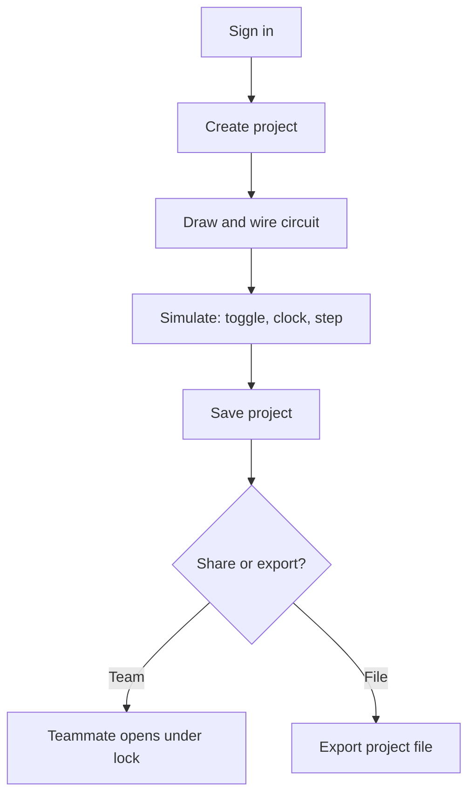
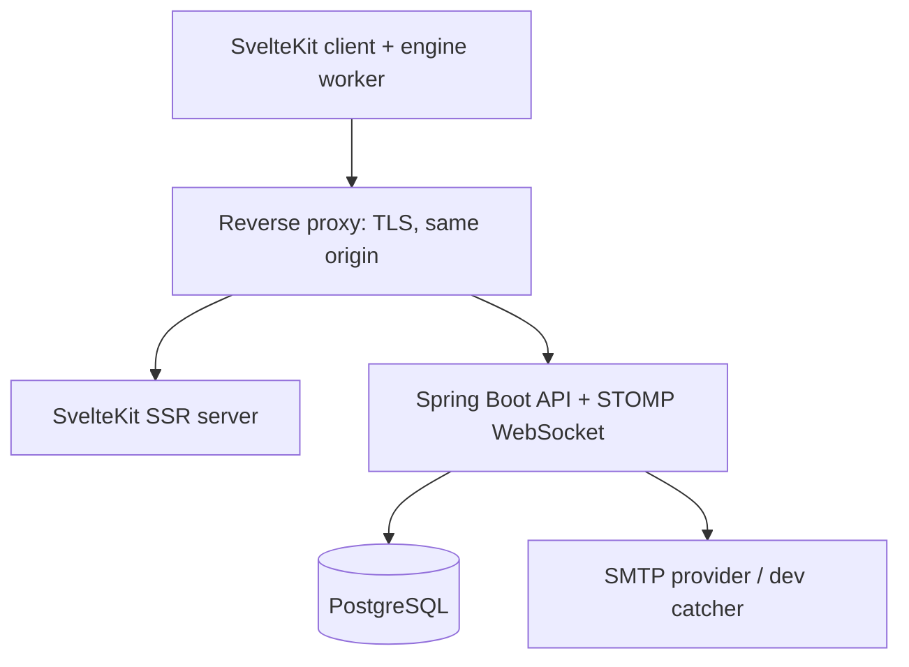
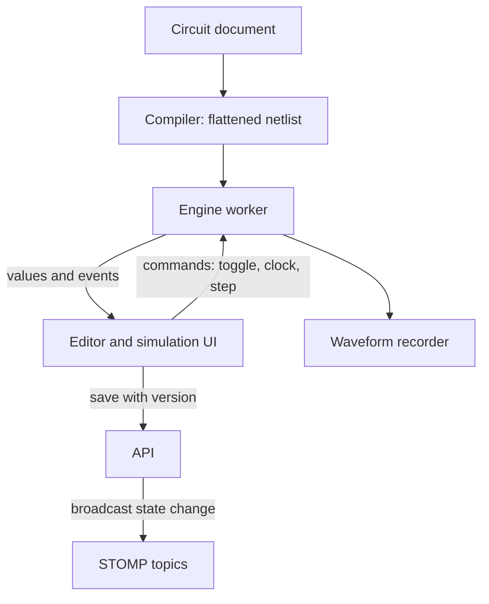
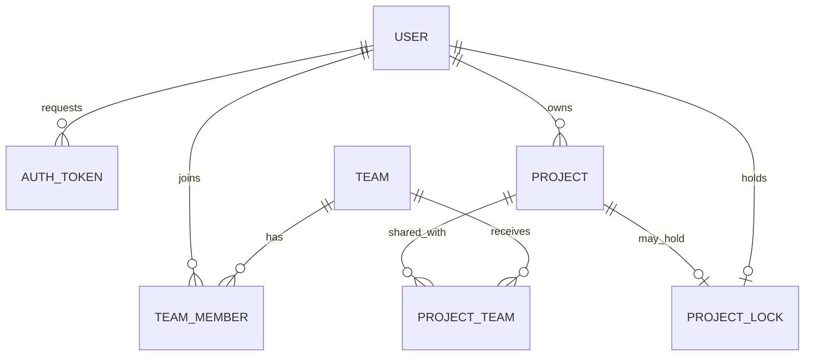
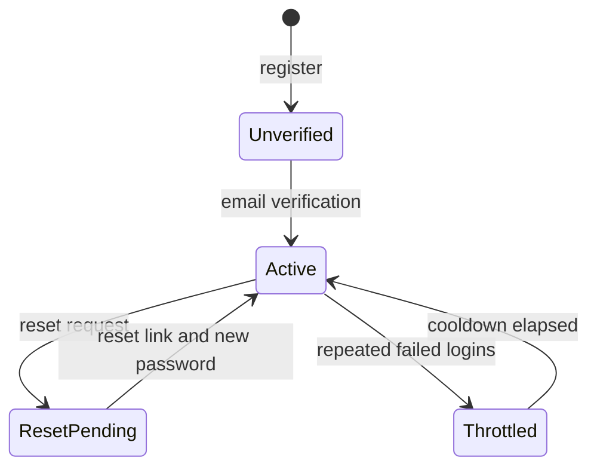
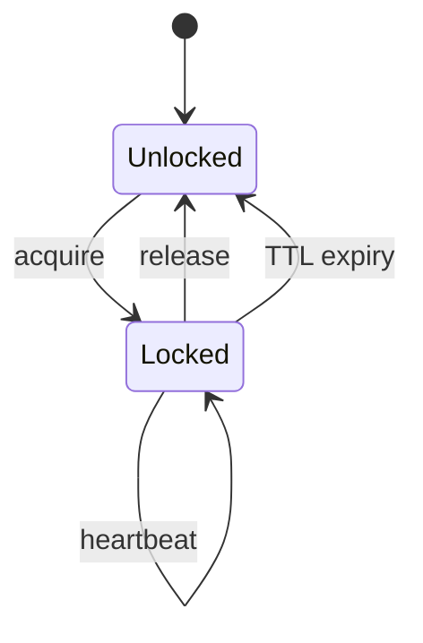

# CircuitGate Logic Simulator v1 - Plan

## Goal Capsule

- Objective: A student signs in from any browser, draws logic circuits up to ALU scale, simulates them with logically correct results, and shares or exports projects with university teammates — no installation, no obsolete tooling.
- Means: A SvelteKit browser client with a custom delta-cycle simulator running in a Web Worker, and a Spring Boot API with PostgreSQL for accounts, projects, teams, sharing, and realtime state (KTD1, KTD4, KTD5, KTD9).
- Product authority: The project owner decides scope. This plan owns the logic-simulator slice; analog simulation, PCB fabrication, text entry, and the rest of the integrated suite are not active scope.
- Stop conditions: Stop and surface the conflict if implementation evidence invalidates a session-settled decision, or if the acceptance examples cannot be met without changing product scope — do not silently resolve either.
- Execution profile: Solo owner with an implementation agent; test-first for engine and backend behavior per the project's engineering instructions; no simultaneous co-editing — realtime propagates state, not concurrent edits.
- Ownership: The implementation agent completes units and keeps CI green; the owner performs deployment and operational setup.
- Open blockers: none.

---

## Output Structure

```text
circuitgate/
  README.md
  compose.yaml
  docs/
    plans/2026-10-04-1543-feat-circuitgate-logic-v1-plan.md
    operations.md
  frontend/
    package.json
    svelte.config.js
    vite.config.ts
    src/
      app.html
      lib/
        api/            # API client, CSRF handling
        engine/         # simulator core (pure TypeScript)
        model/          # circuit document types and schema
        render/         # canvas scene, culling, hit testing
        realtime/       # WebSocket client and stores
        sim/            # worker protocol, session, recorder
        state/          # circuit store, selection
        components/     # editor, sim controls, waveform
      routes/
        (auth)/         # register, verify, login, reset
        (app)/          # dashboard, projects, teams
      workers/          # engine.worker.ts
    tests/e2e/          # Playwright specs and fixtures
  backend/
    pom.xml
    src/main/
      java/.../circuitgate/
        account/        # users, tokens, mail, auth config
        project/        # projects, persistence
        team/           # teams, membership
        sharing/        # project sharing
        lock/           # edit locks
        realtime/       # WebSocket config and publisher
        config/         # security, web, mail configuration
      resources/
        application.yml
        db/migration/   # Flyway SQL
    src/test/java/.../circuitgate/
```

The tree is a scope declaration; per-unit `**Files:**` lists are authoritative.

---

## Product Contract

### Summary

CircuitGate v1 is a browser-based logic circuit editor and simulator with full account management, teams, project sharing, and realtime state updates. Students draw circuits from gates, flip-flops, memory blocks, and reusable subcircuits, then simulate them interactively with clock/step controls and a waveform viewer. Projects live on the server, can be shared with a team, and can be exported as files — a modern replacement for TKGate and the first slice of a design → simulate → fabricate suite.

### Problem Frame

Digital-logic coursework runs on TKGate, which the owner and university colleagues consider obsolete. The pain is concrete: the tool the course expects is aging, clunky, and unpleasant to use for the circuits students actually want to build — an ALU up to a small CPU.

Existing modern simulators exist, but the owner wants an owned, tailored tool: one the owner builds, shapes, and can extend toward the longer-term ambition of analog simulation and real PCB fabrication. Collaboration matters too: university work happens in teams, and today's workflow has no shared project home.

The owner's stated failure mode is abandonment, so v1 must be small enough to finish and useful enough to keep alive.

### Key Decisions

- **Web app with backend, not a desktop app** (session-settled: user-directed — chosen over desktop after the tradeoff was shown: no-install access and built-in sharing beat offline/local ownership). Governs R16.
- **Accounts → teams → sharing all land in v1, built in that order** (session-settled: user-directed — chosen over smaller backend phases: accepted auth, storage, security, and maintenance load for the share-with-teammates workflow). Governs R11–R15.
- **Logic simulation is v1; analog and PCB follow later** (session-settled: user-directed — chosen over analog-first or PCB-first slices: smallest correct v1 against abandonment risk). Governs R1–R10.
- **Schematic-first entry; text/HDL later** (session-settled: user-directed — chosen over text-only or both-at-once entry). Governs R4.
- **Standalone logic tool now; no investment in an analog/PCB foundation** (session-settled: user-directed — chosen over integrated-foundation or CPU-workbench approaches: smallest correct v1 against abandonment risk).
- **Sharing grants project access, not real-time co-editing; an open project is locked to other editors** (session-settled: user-directed — chosen over last-write-wins or merge prompts: no silent data loss). Governs R13, R14.
- **ALU scale is the v1 quality bar; CPU-scale performance can improve later** (session-settled: user-directed — chosen over requiring strict CPU-scale interactivity). Governs R10.

### Actors

- A1. Student author — designs circuits, owns projects, creates teams, shares projects; the primary user.
- A2. Team member — a classmate who opens and edits projects shared with their team, subject to the lock rule.
- A3. Platform operator — maintains the deployed service (accounts, storage, availability); held by the owner in v1.

### Requirements

**Circuit design**

- R1. Users draw circuits on a schematic canvas by placing logic components (gates, flip-flops) and wiring them together.
- R2. Any circuit can be packaged as a reusable subcircuit and instantiated in other circuits, with nesting.
- R3. The component set includes interactive controls (switches, buttons) and indicators (probes, LEDs) usable during simulation.
- R4. v1 accepts schematic entry only; text/HDL entry is deferred.

**Simulation**

- R5. Simulation is event-driven: toggling an input updates dependent outputs immediately.
- R6. Users drive sequential circuits with run, single-step, and pause clock controls.
- R7. Circuits with feedback (latches, oscillators) settle deterministically under a defined delay convention.
- R8. ROM, RAM, and register-file primitives are available for CPU-scale designs.
- R9. A waveform viewer records signal history during simulation and displays it over time.
- R10. Simulation stays interactive at ALU scale on typical student hardware; CPU-scale speed is not a v1 acceptance bar.

**Accounts, teams, sharing**

- R11. Users create accounts and sign in; projects belong to an account.
- R12. Users create teams and add members.
- R13. A project can be shared with a team; members can open and edit a shared project.
- R14. While a project is open by one editor, other members see it as locked (read-only or busy notice) until the editor saves and releases it.
- R15. Projects can be exported to a file and imported back.

**Delivery**

- R16. The app runs in a modern browser with no installation; a backend hosts accounts, project storage, and sharing.

### Key Flows

- F1. Create and simulate a circuit
  - **Trigger:** A signed-in student starts a new project.
  - **Actors:** A1
  - **Steps:** Place components, wire them, toggle inputs or step the clock, watch outputs and waveforms, save.
  - **Covered by:** R1, R3, R5, R6, R9
- F2. Team sharing
  - **Trigger:** The owner wants a classmate to work on a project.
  - **Actors:** A1, A2
  - **Steps:** Create a team, add the classmate, share the project, classmate opens it (locked to others while open), edits, saves, releases.
  - **Covered by:** R11, R12, R13, R14
- F3. Build an ALU and CPU-style design
  - **Trigger:** A course assignment or personal goal needs a larger build.
  - **Actors:** A1
  - **Steps:** Build and save subcircuits, assemble them behind a top-level circuit, add memory primitives, clock the design, inspect signals in the waveform viewer.
  - **Covered by:** R2, R6, R8, R9
- F4. Export and import
  - **Trigger:** A student wants a backup or an offline hand-off.
  - **Actors:** A1, A2
  - **Steps:** Export a project to a file, import it under another account or machine, continue editing.
  - **Covered by:** R15



### Acceptance Examples

- AE1. ALU correctness
  - **Covers R1, R2, R5, R6.**
  - **Given:** A student builds an 8-bit ALU from gates and saved subcircuits.
  - **When:** Each operation's inputs are applied in simulation.
  - **Then:** Outputs match the expected results for every operation.
- AE2. Feedback determinism
  - **Covers R7.**
  - **Given:** An SR latch built from gates.
  - **When:** Inputs change.
  - **Then:** The circuit settles to the same state on every run under the defined delay convention.
- AE3. Shared-project lock
  - **Covers R13, R14.**
  - **Given:** A project shared with a team.
  - **When:** Member A opens it for editing.
  - **Then:** Member B opens it read-only or sees a busy notice; once A saves and releases, B can edit.
- AE4. Export round-trip
  - **Covers R15.**
  - **Given:** A project containing subcircuits and memory blocks.
  - **When:** It is exported and imported on another account.
  - **Then:** Structure and simulation results are identical.
- AE5. CPU-scale correctness
  - **Covers R6, R8, R9, R10.**
  - **Given:** A small CPU design.
  - **When:** It is clocked through a program.
  - **Then:** Instructions produce correct results and the waveform shows the expected signals; speed is not asserted.

### Success Criteria

- The owner builds a working ALU and trusts its results: every operation is logically correct.
- Toggling inputs and stepping the clock feel immediate at ALU scale.
- A classmate opens a shared project and runs it without instructions.
- Export and import round-trip without loss.
- CPU-scale designs simulate correctly; their speed is not a v1 criterion.

### Scope Boundaries

**Deferred for later**

- Analog/electronic simulation — its own future brainstorm.
- PCB layout, routing, and fabrication output (Gerber) — later per the accepted logic → analog → PCB roadmap.
- Text/HDL circuit entry.
- Importing existing TKGate/Logisim circuits.
- CPU-scale performance tuning.
- View-only or link-based sharing — v1 grants edit access through team membership only.
- Account deletion, two-factor authentication, and university SSO.

**Outside this product's identity**

- Real-time simultaneous co-editing — sharing is access-based with locks.
- Offline-first operation — v1 assumes connectivity for accounts and storage.
- Mobile and native desktop clients.

**Deferred to Follow-Up Work**

- External message broker and multi-instance backend scaling.
- Waveform export (VCD) and editor undo/redo.
- Email deliverability hardening (SPF/DKIM) once a sending domain exists.

<!-- ce-section: work-relationships -->

### How This Work Fits Together

This plan covers the logic-simulator slice with its account, team, sharing, and realtime state foundation. The broader breakdown below is the current understanding, not a committed roadmap.

- Logic simulation with accounts, teams, sharing — this plan.
- Analog/electronic simulation — later; depends on the backend and project model this plan establishes.
- PCB layout and fabrication output — later; can proceed independently of analog simulation once a circuit representation exists.
- Text/HDL entry — later; shares the simulation engine; still to decide its scope.
- TKGate/Logisim import — can proceed independently; not scheduled.

### Dependencies / Assumptions

- Greenfield: the repository is empty — no existing code, conventions, or CI to reuse.
- Hosting and operational budget exist for the backend; maintenance is the project's top risk, so v1 stays lean.
- Users are university students on modern browsers with connectivity while using the app.
- Email-based accounts are sufficient; university SSO is not required.

### Sources / Research

- Current course tool: TKGate — judged obsolete by the owner; motivation for this work.
- Alternatives considered: Logisim Evolution, Digital (hneemann), Falstad, CircuitVerse — the owner chose an owned, tailored tool instead.

---

## Planning Contract

Product Contract preservation: unchanged except for question resolution — the three previously deferred items are resolved in place (delay convention → KTD4; permission detail → KTD8 and Scope Boundaries; performance targets → Verification Contract), and Scope Boundaries now names additional deferrals. R/A/F/AE IDs and meanings are preserved.

### Key Technical Decisions

- KTD1. **Stack and runtime shape.** Monorepo with a TypeScript frontend (Svelte 5 + latest SvelteKit, SSR active, Bun tooling) and a Java 25 backend (Spring Boot 4.1.x, Spring Security 7, Spring Data JPA/Hibernate, PostgreSQL, Flyway), JSON REST API, same-origin behind a reverse proxy in production, dev proxy in development. SSR serves unauthenticated routes and the app shell; the authenticated editing UI is client-rendered; the SvelteKit server emits a nonce-based CSP with `frame-ancestors 'none'`, `X-Content-Type-Options: nosniff`, and `Referrer-Policy: no-referrer`. (session-settled: user-directed — chosen over Python, Bun-backend, and Quarkus alternatives; Boot 4.1.x chosen over Boot 3 because the 3.5 line's OSS support ended mid-2026.) Governs R16.
- KTD2. **Session auth, no tokens.** Server-side sessions with sliding expiry and remember-me; JSON login through Spring Security; session cookie with the `__Host-` prefix carrying `HttpOnly; Secure; SameSite=Lax`; session ids rotate on login and privilege change; sessions persist in PostgreSQL through Spring Session JDBC so restarts and future multi-instance deployment do not drop logins; remember-me uses persistent series/token records, hashed at rest, rotated per use, with replay of an old token revoking the series; logout-all and password reset or change delete every remember-me record for the account; BCrypt via `DelegatingPasswordEncoder`; CSRF uses the SPA token mechanism, binds the token to the session, rotates it on authentication, covers the login request, and never relaxes SameSite to `None`. (session-settled: user-directed — chosen over JWT access + refresh tokens: same-origin sessions keep revocation and logout-all trivial.) Governs R11.
- KTD3. **Full account lifecycle.** Registration with email verification required before sign-in; single-use, hashed, expiring tokens for verification and password reset; password change revokes other sessions; logout current or all devices; failed-login throttling per account and per IP. Mail goes through an interface with an SMTP implementation in production and a local catcher in development. Verification and reset tokens are 256-bit random values stored only as hashes with a lookup index and consumed by a single conditional update, so exactly one redemption succeeds; a reset revokes all sessions, remember-me records, and other pending tokens; request endpoints share the throttling policy; responses and timing are uniform for known and unknown emails, and duplicate registration sends a notice instead of revealing account existence; throttling uses exponential backoff with a capped, self-recovering cooldown, counts per account and per source address only when that address is derived through the configured trusted proxy, persists counters in the database so restarts do not reset them, and renders throttled attempts indistinguishable from bad credentials; a verification resend invalidates the previous token and is rate-limited; used and expired tokens are purged on a schedule. (session-settled: user-directed — chosen over an email+password-only v1: the owner required full account management.) Governs R11.
- KTD4. **Simulation semantics.** Zero-delay delta-cycle settling with a stable total order (component id), two-phase evaluate/commit, four-state values (0/1/X/Z), nets starting X; a delta-cycle cap (default 1000) marks involved nets X, flags oscillation, and halts the pass; a timed mode with uniform unit delay and a scheduled clock makes ring oscillators and time-accurate waveforms observable. Value presentation is shared across canvas, indicators, and waveform: high, low, unknown, high-impedance, and a distinct oscillating treatment. Step semantics: delta-cycle mode steps one settle pass; timed mode advances one unit-delay tick. Governs R5, R6, R7, R9.
- KTD5. **Engine execution model.** The circuit document compiles to a flattened netlist (typed arrays, fanout lists, leaf primitives); events carry component id plus version and deduplicate; edits recompile; the engine runs in a Web Worker behind a versioned SimulationSession contract — commands, events, and capabilities — so main-thread code never depends on delta-cycle internals; waveform recording runs inside the worker; the worker emits structured compile-error events, coalesces value updates per frame, and can respawn from the document after a crash. Concepts are borrowed only from permissively licensed prior art; no GPL engine code is reused. Governs R2, R5, R8, R10.
- KTD6. **Rendering.** Hand-rolled Canvas 2D for the schematic with viewport culling and a spatial index, DOM overlay for selection and control widgets, and a custom canvas waveform viewer over per-net change lists. Governs R1, R3, R9.
- KTD7. **Project persistence and concurrency.** A project is metadata plus an opaque versioned circuit document (JSONB) with a version counter; saves use an optimistic version check; export and import use the same versioned document schema. The document is layered (semantics, layout, meta) with a schema version kept separate from the content version. The server validates envelope, supported schema version, payload size, nesting depth, and string limits on every write and never interprets semantics; the client validates document structure — depth, definition-cycle detection, component and pin counts, id uniqueness, referential integrity, memory sizing — before compiling a loaded or imported document. The document schema evolves additively with read-compatibility, or by migration before deploy. Governs R13, R15.
- KTD8. **Sharing and locks.** Team membership grants edit access; projects are shared with teams through a join table; an edit lock is an exclusive row with holder, acquisition time, TTL, and heartbeat; a conflicting open is read-only or shows busy; expiry releases. A project has at most one active lock, enforced by a unique constraint; acquisition is a single atomic write that maps a uniqueness violation to busy; release and heartbeat succeed only for the current holder of an unexpired lock; all time comparisons use the database clock; the heartbeat interval stays below the TTL, renews on tab visibility and focus, and the TTL is chosen to survive browser background-timer throttling and laptop sleep. Save does not release the lock — release is explicit, with a best-effort unload beacon, and the TTL is crash safety only. A holder that loses the lock drops to read-only with its draft kept; a save against an expired or reassigned lock fails as a recoverable conflict. Member removal, unshare, team deletion, and project deletion force-release affected locks in the same transaction. Owner/member are the only roles; no view-only links in v1. Governs R12, R13, R14.
- KTD9. **Realtime state propagation.** STOMP over WebSocket with an in-memory broker on a single backend instance; the handshake authenticates against the HTTP session and subscriptions authorize per topic; the server broadcasts lock changes, project saves (version), share changes, and team membership changes. The handshake validates the Origin, authenticates against the HTTP session, and re-authenticates on reconnect; SUBSCRIBE is authorized per topic; client SEND to broadcast destinations is rejected — publishing happens only server-side through a domain-event port, after commit; session destruction and membership or share revocation close or unsubscribe affected sessions. Every event carries a monotonic project version or lock epoch; clients apply only newer events and refetch on reconnect, focus, or conflict, and each topic maps to a resource for resynchronization. Realtime stays advisory; the database remains authoritative. This propagates state; it does not add simultaneous co-editing. (session-settled: user-directed — chosen over polling: the owner asked for app-wide realtime state variation.) Governs R12, R13, R14.
- KTD10. **Deployment shape.** Docker Compose runs frontend, backend, PostgreSQL, and a TLS-terminating reverse proxy on one host; SMTP access is configured by environment; database volume and backups are documented. TLS terminates at the proxy with HSTS; inbound forwarded headers are stripped and re-derived from a configured trusted proxy; same-origin checks are asserted on state-changing requests. Sessions live in PostgreSQL (KTD2); the in-memory realtime broker constrains v1 to a single backend instance until an external broker replaces it. Governs R16.

### High-Level Technical Design











### System-Wide Impact

- Authorization: one shared access component serves REST and STOMP; project access is owner or current team membership, re-checked at every write.
- Validation ownership: the server validates envelope, schema version, size, depth, and metadata charset on every write; the client validates document structure and compile safety (KTD7).
- Failure propagation: database down shows retryable API errors and pauses realtime; mail down reports retryable registration and reset failures; worker crash respawns from the document; WebSocket loss leaves advisory data stale until the reconnect refetch; lock loss demotes the editor to read-only with its draft kept.
- Migration seams: sessions in PostgreSQL; broker behind a port with an in-memory adapter; engine behind the SimulationSession contract; document semantics namespaced for the future analog engine.
- Observability: structured logs with correlation ids for auth, lock, share, and WebSocket lifecycle; no secrets or tokens in logs.
- SSR boundary: unauthenticated routes and the app shell render server-side; the authenticated editor renders client-side.

### Assumptions

- Hosting is undecided; Compose runs on a VPS, a PaaS, or a university machine without code changes.
- One backend instance; sessions persist in PostgreSQL through Spring Session JDBC (KTD2), and the in-memory STOMP broker constrains v1 to a single instance (KTD10) — scaling later needs an external broker.
- A transactional email path is available in production; development uses a local catcher.
- Email verification is required before sign-in.
- Team roles are owner and member only; any member may share their own projects with the team.
- Target scale is tens of users and tens of projects; project payloads stay under a few megabytes.
- Modern browsers with Web Workers and WebSockets.
- SvelteKit's latest major and Spring Boot 4.1.x are fresh; versions are pinned and verified in U1.

### Risks & Dependencies

- SvelteKit 3 and running the SvelteKit server on Bun are fresh; fallback is Node 22 with the Node adapter (or a SvelteKit 2 pin). Version pinning and a U1 smoke cover this.
- Spring Boot 4.1.x on Java 25 is a new combination; U1 verifies application startup and persistence against a Testcontainers database. Fallback is the previous Boot 4.0.x line.
- Testcontainers 2.x renamed its PostgreSQL artifacts; stale tutorials use old coordinates.
- The SPA CSRF mechanism is new; the account integration tests assert the token flow end to end.
- WebSocket authorization is the most security-sensitive new surface; per-topic authorization and unauthenticated-handshake tests are mandatory.
- Multiword arithmetic above 32 bits is a correctness hotspot; vector tests exercise 64-bit operations.
- Waveform retention can grow unbounded; the recorder carries a retention cap and decimation policy.
- Abandonment remains the top project risk: Phase A alone yields a usable standalone tool, so a stall still leaves value.
- Email misconfiguration can block sign-in entirely; the dev catcher, a resend path, and operator notes mitigate this.
- Lock, save, and revocation races are guarded by database constraints plus concurrency tests; an invariant that cannot be enforced atomically stops the unit rather than shipping a race.

### Sequencing

- Phase A — Standalone logic tool: U1–U5.
- Phase B — Accounts and projects: U6–U8.
- Phase C — Teams, sharing, realtime: U9–U10.
- Phase D — End-to-end validation and deployment: U11.

---

## Implementation Units

| U-ID | Title | Files touched (key) | Depends on |
|---|---|---|---|
| U1 | Monorepo, toolchain, CI, dev environment | `frontend/`, `backend/`, `compose.yaml`, `.github/workflows/ci.yml` | — |
| U2 | Circuit model and delta-cycle engine core | `frontend/src/lib/{model,engine}/` | U1 |
| U3 | Primitives, memory, subcircuits | `frontend/src/lib/engine/primitives/`, `hierarchy.ts` | U2 |
| U4 | Schematic editor canvas | `frontend/src/lib/{render,components/editor,state}/` | U2, U3 |
| U5 | Simulation UI, waveform viewer, worker | `frontend/src/{workers,lib/sim,lib/components/{sim,waveform}}/` | U2–U4 |
| U6 | Backend foundation and account lifecycle | `backend/src/main/java/.../account/`, `config/`, `db/migration/V1` | U1 |
| U7 | Projects API, persistence, export/import | `backend/.../project/`, `db/migration/V2` | U6 |
| U8 | Frontend auth, dashboard, project persistence | `frontend/src/routes/`, `frontend/src/lib/api/` | U4, U6, U7 |
| U9 | Teams | `backend/.../team/`, `db/migration/V3`, `frontend/src/routes/(app)/teams/` | U6, U8 |
| U10 | Sharing, locks, realtime propagation | `backend/.../{sharing,lock,realtime}/`, `frontend/src/lib/realtime/` | U5, U7, U8, U9 |
| U11 | End-to-end validation, deployment, operations | `frontend/tests/e2e/`, Dockerfiles, `compose.yaml`, `docs/operations.md` | U1–U10 |

### U1. Monorepo, toolchain, CI, and dev environment

- **Goal:** A green build on both sides, a containerized dev database and mail catcher, and CI running both suites.
- **Requirements:** R16 (KTD1, KTD10).
- **Dependencies:** none.
- **Files:** `README.md`, `.gitignore`, `.github/workflows/ci.yml`, `compose.yaml`, `frontend/package.json`, `frontend/svelte.config.js`, `frontend/vite.config.ts`, `frontend/src/app.html`, `frontend/src/routes/+page.svelte`, `backend/pom.xml`, `backend/src/main/java/.../circuitgate/CircuitGateApplication.java`, `backend/src/main/resources/application.yml`, `backend/src/test/java/.../circuitgate/ApplicationSmokeTest.java`.
- **Approach:** Scaffold SvelteKit with pinned versions (Svelte 5, current SvelteKit major, Vite, TypeScript) and Bun as package manager; scaffold Spring Boot 4.1.x with the Maven wrapper on Java 25; add Testcontainers dependencies; Compose provides PostgreSQL 17 and a development mail catcher; CI has a frontend job and a backend job. The git repository is initialized locally; the owner creates the remote before the first push.
- **Execution note:** Mostly scaffolding and configuration; prefer build and runtime smoke verification over unit coverage.
- **Test scenarios:** Test expectation: none — scaffolding. Smoke evidence: frontend production build succeeds; backend loads its context against a Testcontainers PostgreSQL; `docker compose up` reports the database healthy.
- **Verification:** CI is green on both jobs; a fresh clone builds with documented commands.

### U2. Circuit document model and delta-cycle engine core

- **Goal:** A pure TypeScript engine that compiles a circuit document to a flattened netlist and evaluates it deterministically, including feedback and oscillation detection.
- **Requirements:** R5, R7 (KTD4, KTD5); covers the feedback acceptance example AE2.
- **Dependencies:** U1.
- **Files:** `frontend/src/lib/model/circuit.ts`, `frontend/src/lib/model/schema.ts`, `frontend/src/lib/engine/compile.ts`, `frontend/src/lib/engine/values.ts`, `frontend/src/lib/engine/evaluate.ts`, `frontend/src/lib/engine/eventQueue.ts`, `frontend/src/lib/engine/index.ts`, `frontend/src/lib/engine/__tests__/evaluate.test.ts`, `frontend/src/lib/engine/__tests__/feedback.test.ts`, `frontend/src/lib/engine/__tests__/values.test.ts`.
- **Approach:** Compile document to netlist; two-phase evaluate/commit with stable ordering; four-state value algebra with explicit X propagation; delta-cycle cap returning a structured oscillation result; timed mode with uniform delay and a clock source; pure functions with no DOM dependency.
- **Execution note:** Implement engine behavior test-first; write the failing vectors before the implementation.
- **Test scenarios:**
  - AND, OR, NOT, XOR truth tables over all input combinations.
  - X on an input propagates X according to each primitive's semantics.
  - Half-adder and full-adder vectors produce correct sum and carry.
  - Covers AE2: an SR latch settles to a stable state from each input sequence, identical on every run.
  - An SR latch with both inputs asserted then released produces the same defined result on every run.
  - A combinational cycle (inverter ring) exceeds the delta-cycle cap, marks involved nets X, and flags oscillation without looping forever.
  - Timed mode: a ring oscillator toggles at the expected unit-delay period.
  - Evaluating an unchanged circuit repeatedly is idempotent.
- **Verification:** Engine suite green; the oscillation cap test terminates deterministically.

### U3. Primitive library, memory, and subcircuits

- **Goal:** The full primitive set including sequential and memory components, plus subcircuit packaging with flatten-on-compile and unchanged timing.
- **Requirements:** R2, R6, R8 (KTD5).
- **Dependencies:** U2.
- **Files:** `frontend/src/lib/engine/primitives/gates.ts`, `frontend/src/lib/engine/primitives/flipflops.ts`, `frontend/src/lib/engine/primitives/mux.ts`, `frontend/src/lib/engine/primitives/decoder.ts`, `frontend/src/lib/engine/primitives/adders.ts`, `frontend/src/lib/engine/primitives/memory.ts`, `frontend/src/lib/engine/hierarchy.ts`, `frontend/src/lib/engine/__tests__/primitives.test.ts`, `frontend/src/lib/engine/__tests__/hierarchy.test.ts`, `frontend/src/lib/engine/__tests__/memory.test.ts`.
- **Approach:** Primitives as leaf components; subcircuit instances flatten during compilation so timing semantics match a hand-flattened build; memory primitives hold initialization content; bus values use multiword arrays.
- **Test scenarios:**
  - D, JK, SR flip-flop and register vectors including clock-edge behavior.
  - Multiplexer and decoder truth tables.
  - 4-bit ripple-carry adder and 8-bit operation vectors.
  - Nested subcircuit produces identical results to its flattened equivalent.
  - ROM read returns initialized contents; RAM write then read across cycles; register file supports two reads and one write per cycle.
  - 64-bit addition and comparison vectors exercise multiword arithmetic.
  - Self-referential or mutually recursive subcircuit definitions are rejected with a structured compile-error event before flattening.
- **Verification:** All vector suites green.

### U4. Schematic editor canvas

- **Goal:** Place, wire, select, move, and delete components; pan and zoom; render through canvas with culling; all edits mutate the circuit document.
- **Requirements:** R1, R3 (KTD6).
- **Dependencies:** U2, U3.
- **Files:** `frontend/src/lib/components/editor/Canvas.svelte`, `frontend/src/lib/components/editor/Palette.svelte`, `frontend/src/lib/components/editor/Inspector.svelte`, `frontend/src/lib/render/scene.ts`, `frontend/src/lib/render/culling.ts`, `frontend/src/lib/render/geometry.ts`, `frontend/src/lib/render/hitTest.ts`, `frontend/src/lib/state/circuitStore.ts`, `frontend/src/lib/state/selection.ts`, `frontend/src/routes/(app)/projects/[id]/+page.svelte`, `frontend/src/lib/render/__tests__/geometry.test.ts`, `frontend/src/lib/render/__tests__/hitTest.test.ts`, `frontend/src/lib/render/__tests__/culling.test.ts`.
- **Approach:** Viewport transform shared by render and hit testing; spatial index for culling and pointer queries; wire routing as polylines between pins; selection in a DOM overlay; editing operations produce new document revisions with stable ids. The editor lives on the project route `(app)/projects/[id]`; there is no standalone editor route. Subcircuit authoring is in-editor: a package-selection action, a pin-interface step, breadcrumb navigation into nested definitions, and instance editing. The Inspector edits memory contents and sizes, bus widths, component labels, flip-flop type, and clock polarity, round-tripping into the document. Signal values render per the KTD4 presentation convention.
- **Test scenarios:**
  - Hit testing returns the correct component at multiple zoom and pan values.
  - Culling excludes offscreen components and includes boundary components.
  - A wire connects two pins; connecting a pin to itself is rejected; dangling wires are rejected on drop.
  - Grid snapping places components predictably at multiple zoom levels.
  - Multi-selection move and delete mutate only the selected components.
  - Performance smoke: a 2,000-component document renders within the frame budget.
  - Packaging a selection as a subcircuit, instantiating it, and editing the nested definition round-trips; the result matches a flattened equivalent.
  - Inspector property edits (memory contents, widths, labels, flip-flop type, polarity) persist into the document.
- **Verification:** Unit tests green; manual editor smoke covers place-wire-simulate.

### U5. Simulation UI, clock controls, waveform viewer, and worker

- **Goal:** Run the engine in a Web Worker; toggle inputs, run/step/pause the clock, observe values live, and record and display waveforms.
- **Requirements:** R3, R5, R6, R9 (KTD4, KTD5, KTD6); contributes to AE5.
- **Dependencies:** U2, U3, U4.
- **Files:** `frontend/src/workers/engine.worker.ts`, `frontend/src/lib/sim/protocol.ts`, `frontend/src/lib/sim/session.ts`, `frontend/src/lib/sim/recorder.ts`, `frontend/src/lib/components/sim/Controls.svelte`, `frontend/src/lib/components/sim/Probe.svelte`, `frontend/src/lib/components/sim/Diagnostics.svelte`, `frontend/src/lib/components/waveform/WaveformViewer.svelte`, `frontend/src/lib/components/waveform/lane.ts`, `frontend/src/lib/sim/__tests__/protocol.test.ts`, `frontend/src/lib/sim/__tests__/recorder.test.ts`, `frontend/src/lib/components/waveform/__tests__/lane.test.ts`.
- **Approach:** Versioned command/event protocol behind the SimulationSession contract; the worker owns the compiled netlist and simulation state; controls send toggle, clock, step, pause, reset; the recorder runs inside the worker and stores per-net change lists; value events are coalesced per frame; the worker emits structured compile-error events and respawns from the document after a crash; the viewer virtualizes lanes and binary-searches by time; a retention cap bounds memory. Controls expose the simulation mode — delta-cycle or timed — with mode-appropriate step semantics (KTD4); compile errors and oscillation flags surface in a diagnostics panel with navigation to affected components.
- **Test scenarios:**
  - Protocol round-trip delivers commands and events with correlation ids.
  - Clock stepping advances the simulation by the expected number of ticks; pause stops advancement.
  - Toggling an input produces the expected propagated event sequence.
  - Recorder stores only value changes, not every tick; binary search returns the correct value at an arbitrary time.
  - Retention cap bounds stored history for long runs.
  - Latency smoke: toggle-to-render stays within the ALU-scale budget.
  - A malformed document yields a structured compile-error event instead of a hang.
  - A worker crash respawns from the document; simulation restarts from its initial state (state is not preserved).
  - Switching to timed mode produces a toggling waveform for a ring oscillator.
  - Compile errors and oscillation surface in the diagnostics panel, which links to affected components; dismissal clears the banner.
- **Verification:** Unit tests green; interactive smoke at ALU scale; values update live in the editor.

### U6. Backend foundation, schema, and full account lifecycle

- **Goal:** A Spring Boot service with the initial schema, session auth, and the complete account lifecycle: registration, email verification, login, password reset, password change, logout (current and all), and failed-login throttling.
- **Requirements:** R11, R16 (KTD1, KTD2, KTD3).
- **Dependencies:** U1.
- **Files:** `backend/src/main/java/.../circuitgate/config/SecurityConfig.java`, `backend/src/main/java/.../circuitgate/config/WebMvcConfig.java`, `backend/src/main/java/.../circuitgate/config/SessionConfig.java`, `backend/src/main/java/.../circuitgate/account/AccountController.java`, `backend/src/main/java/.../circuitgate/account/AccountService.java`, `backend/src/main/java/.../circuitgate/account/TokenService.java`, `backend/src/main/java/.../circuitgate/account/MailService.java`, `backend/src/main/java/.../circuitgate/account/User.java`, `backend/src/main/java/.../circuitgate/account/AuthToken.java`, `backend/src/main/resources/db/migration/V1__users_and_auth_tokens.sql`, `backend/src/main/resources/application.yml`, `backend/src/test/java/.../circuitgate/account/RegistrationFlowTest.java`, `backend/src/test/java/.../circuitgate/account/PasswordResetFlowTest.java`, `backend/src/test/java/.../circuitgate/account/ThrottlingTest.java`, `backend/src/test/java/.../circuitgate/account/SessionSecurityTest.java`, `backend/src/test/java/.../circuitgate/account/SessionPersistenceTest.java`.
- **Approach:** JSON login and logout endpoints through Spring Security; token redemption is a single conditional update; sign-in denied while unverified; password change invalidates other sessions and remember-me records; logout-all uses the session registry and closes affected WebSocket sessions; sessions are stored through Spring Session JDBC so they survive restarts; throttling counters persist in the database and derive the source address only through the trusted proxy; mail behind an interface with SMTP and catcher implementations; login is CSRF-protected and the session id rotates on authentication.
- **Execution note:** Start with failing integration tests for register → verify → login → reset; implement against Testcontainers PostgreSQL.
- **Test scenarios:**
  - Registration creates an unverified account; login before verification is denied.
  - Verified login establishes a session with correct cookie flags.
  - Wrong password repeated to the threshold throttles the account and the source address.
  - Reset token is single-use and expires; an expired token is rejected.
  - Password change revokes other sessions but keeps the current one.
  - Logout-all invalidates every session for the account.
  - State-changing requests without a CSRF token are rejected.
  - Duplicate registration does not reveal account existence; a notice is sent instead of an error.
  - Mail delivery failure surfaces a retryable error without losing the account state.
  - Session id changes across login; a pre-authentication session id is useless afterward.
  - A replayed rotated remember-me token revokes the series.
  - Two parallel redemptions of one reset token yield exactly one success.
  - Known and unknown emails produce indistinguishable reset responses and timing.
  - A spoofed forwarded address from an untrusted source does not affect throttling; the cooldown ends and a successful login resets counters.
  - Verification resend invalidates the previous token and is rate-limited.
  - Sessions survive a backend restart: a session created before restart still authenticates.
- **Verification:** Integration suite green against PostgreSQL; manual smoke via the dev catcher.

### U7. Projects API, persistence, and export/import

- **Goal:** Authenticated project CRUD, versioned saves, and export/import of the versioned circuit document.
- **Requirements:** R11, R15 (KTD7).
- **Dependencies:** U6.
- **Files:** `backend/src/main/java/.../circuitgate/project/ProjectController.java`, `backend/src/main/java/.../circuitgate/project/ProjectService.java`, `backend/src/main/java/.../circuitgate/project/Project.java`, `backend/src/main/java/.../circuitgate/project/ProjectRepository.java`, `backend/src/main/java/.../circuitgate/project/dto/`, `backend/src/main/resources/db/migration/V2__projects.sql`, `backend/src/test/java/.../circuitgate/project/ProjectCrudTest.java`, `backend/src/test/java/.../circuitgate/project/ProjectVersioningTest.java`, `backend/src/test/java/.../circuitgate/project/ExportImportTest.java`.
- **Approach:** Metadata columns plus a layered, opaque JSONB payload and version counter; all queries scoped to the owner or an authorized team; saves are update-only conditional writes where zero affected rows means conflict or gone — never an insert — and access is re-checked at write time; export returns the versioned envelope; import validates envelope and schema version, enforces the size, depth, and string limits, ignores server-owned fields, and creates a new project.
- **Test scenarios:**
  - Create, list, read, update, and delete an owned project.
  - Another user's project is inaccessible by every endpoint.
  - Saving with a stale version is rejected as a conflict.
  - Export then import reproduces the payload exactly.
  - Import rejects a malformed envelope, an unknown schema version, and an oversized payload.
  - Unauthenticated requests are rejected.
  - Oversized and over-deep saves are rejected with the same limits as imports.
  - An unknown schema version is rejected on both save and import.
  - An import envelope carrying owner, share, or lock fields cannot set them.
  - Export filenames are sanitized.
  - A save against a deleted project fails without creating a row; deleting a project force-releases its lock and removes its shares.
- **Verification:** Integration suite green; round-trip proven at the API level.

### U8. Frontend auth flows, dashboard, and project persistence

- **Goal:** SvelteKit routes for register, verify, login, reset, and change password; a dashboard listing projects; editor load/save wired to the API with conflict handling and export/import.
- **Requirements:** R11, R15, R16 (KTD1, KTD2, KTD3, KTD7).
- **Dependencies:** U4, U6, U7.
- **Files:** `frontend/src/routes/(auth)/login/+page.svelte`, `frontend/src/routes/(auth)/register/+page.svelte`, `frontend/src/routes/(auth)/verify/+page.svelte`, `frontend/src/routes/(auth)/reset/+page.svelte`, `frontend/src/routes/(app)/projects/+page.svelte`, `frontend/src/routes/(app)/projects/[id]/+page.svelte`, `frontend/src/routes/(app)/account/+page.svelte`, `frontend/src/routes/(app)/+layout.server.ts`, `frontend/src/lib/api/client.ts`, `frontend/src/lib/api/projects.ts`, `frontend/tests/e2e/auth.spec.ts`, `frontend/tests/e2e/projects.spec.ts`.
- **Approach:** SSR loads forward the session cookie; browser calls stay same-origin; forms validate input client-side; verification and reset pages consume emailed links; the editor saves with the known version and offers reload on conflict; export downloads the document and import uploads it.
- **Test scenarios:**
  - Register → capture the verification link from the catcher → verify → log in.
  - Login and logout through the UI; unauthenticated access to app routes redirects to login.
  - Reset flow: request, consume link, set a new password, log in.
  - Save a project, reload the page, and see identical content.
  - A stale save keeps the local buffer and offers view-latest, save-as-copy, or export — never an automatic overwrite.
  - Export downloads a file; importing it creates an equivalent project.
  - A save returning unauthenticated keeps the local document, asks for sign-in, and completes the save after re-authentication.
  - Project and label metadata containing HTML or control characters renders as inert text.
  - A reset request while throttled succeeds under its own rate limit.
  - The account page changes the password and ends other sessions; log-out-all ends every session.
  - Verify and reset pages show expired-link states with a working resend once the rate limit allows.
- **Verification:** Playwright specs green; manual smoke with the dev mail catcher.

### U9. Teams

- **Goal:** Create teams and manage membership by email; list teams and members.
- **Requirements:** R12 (KTD8).
- **Dependencies:** U6, U8.
- **Files:** `backend/src/main/java/.../circuitgate/team/TeamController.java`, `backend/src/main/java/.../circuitgate/team/TeamService.java`, `backend/src/main/java/.../circuitgate/team/Team.java`, `backend/src/main/java/.../circuitgate/team/TeamMember.java`, `backend/src/main/resources/db/migration/V3__teams.sql`, `frontend/src/routes/(app)/teams/+page.svelte`, `frontend/src/lib/api/teams.ts`, `backend/src/test/java/.../circuitgate/team/TeamMembershipTest.java`, `frontend/tests/e2e/teams.spec.ts`.
- **Approach:** Creator becomes the team owner; members are added by verified account email; membership rows carry the role; only members can view a team; responses avoid leaking whether arbitrary emails exist where that matters.
- **Test scenarios:**
  - Creating a team makes the creator its owner.
  - Adding an existing verified user by email creates a membership.
  - Adding an unknown email is rejected with a clear, non-leaking error.
  - Removing a member works for the owner; the removed member loses access.
  - A non-member cannot read team details or membership.
  - Concurrent adds of the same member produce exactly one membership.
  - The team owner cannot be removed.
- **Verification:** Integration and E2E coverage green.

### U10. Sharing, locks, and realtime state propagation

- **Goal:** Share projects with teams, enforce member access, provide exclusive edit locks with TTL and heartbeat, and push lock, save, share, and membership state changes to connected clients over WebSocket.
- **Requirements:** R12, R13, R14 (KTD8, KTD9); covers AE3.
- **Dependencies:** U5, U7, U8, U9.
- **Files:** `backend/src/main/java/.../circuitgate/sharing/ShareController.java`, `backend/src/main/java/.../circuitgate/sharing/ShareService.java`, `backend/src/main/java/.../circuitgate/sharing/ProjectTeam.java`, `backend/src/main/java/.../circuitgate/lock/LockController.java`, `backend/src/main/java/.../circuitgate/lock/LockService.java`, `backend/src/main/java/.../circuitgate/lock/ProjectLock.java`, `backend/src/main/java/.../circuitgate/realtime/WebSocketConfig.java`, `backend/src/main/java/.../circuitgate/realtime/RealtimePublisher.java`, `backend/src/main/resources/db/migration/V4__sharing_and_locks.sql`, `frontend/src/lib/realtime/client.ts`, `frontend/src/lib/realtime/stores.ts`, `frontend/src/lib/components/editor/LockBanner.svelte`, `frontend/src/lib/components/editor/ShareDialog.svelte`, `frontend/tests/e2e/sharing.spec.ts`.
- **Approach:** Access check is owner or current team membership; sharing writes a project-team join row; a lock is created exclusively with a TTL and extended by heartbeat; expiry and release free it; save keeps the lock and release is explicit; a lock-free broadcast upgrades a waiting read-only editor; revocation of membership or sharing force-releases affected locks and disconnects their sockets; STOMP endpoints validate the Origin, authenticate at handshake against the HTTP session, authorize every subscription, and reject client publishes; the server publishes after commit through the domain-event port; the client reconnects with backoff, re-authenticates, and refetches authoritative state. The editor's lock banner shows the holder, a release control, waiter status, and which actions read-only mode leaves enabled.
- **Test scenarios:**
  - Sharing with a team grants members access; non-members remain denied.
  - Covers AE3: two members opening the same project — the first holds the lock, the second is read-only with a busy notice; release hands the lock over.
  - Heartbeats keep a lock alive past the TTL; no heartbeat lets it expire and become acquirable.
  - A save from a non-holder is rejected.
  - A WebSocket connection without a session is rejected; subscribing to another team's project topic is rejected.
  - Lock, save, share, and membership changes are delivered to the affected members only.
  - Two simultaneous acquisitions yield exactly one winner.
  - A stale release cannot remove a successor's lock; a heartbeat after expiry fails without resurrection.
  - Heartbeat and release from a non-holder are rejected.
  - An expired lock is immediately acquirable even before the sweeper runs.
  - Save does not release the lock; a second tab of the same user is read-only.
  - Saving after lock expiry returns a conflict carrying the latest version and the client keeps its draft.
  - The waiting member's editor enables editing when the release event arrives.
  - The holder releases explicitly from the banner.
  - A throttled or suspended heartbeat followed by focus renewal keeps the lock; a genuinely expired lock surfaces as a recoverable conflict.
  - Logout-all and member removal close affected WebSocket sessions, which stop receiving events.
  - Removing a member force-releases that member's locks on team projects.
  - A handshake with a mismatched Origin, a client publish, and STOMP frames without the CSRF binding are rejected.
  - After reconnect the client re-authenticates and refetches; a rolled-back share or save emits no events, and duplicate or out-of-order events cannot regress client state.
- **Verification:** Integration tests for authorization and locks; Playwright two-user session proves AE3.

### U11. End-to-end validation, deployment, and operations

- **Goal:** Prove the acceptance examples end to end, package deployment, and document operations.
- **Requirements:** R1–R16; covers AE1–AE5.
- **Dependencies:** U1–U10.
- **Files:** `frontend/tests/e2e/alu.spec.ts`, `frontend/tests/e2e/export-import.spec.ts`, `frontend/tests/e2e/realtime.spec.ts`, `frontend/tests/fixtures/alu-project.json`, `frontend/tests/fixtures/cpu-project.json`, `frontend/tests/fixtures/sr-latch-project.json`, `frontend/tests/fixtures/oscillator-project.json`, `frontend/Dockerfile`, `backend/Dockerfile`, `compose.yaml`, `Caddyfile`, `docs/operations.md`, `README.md`, `.github/workflows/ci.yml`.
- **Approach:** E2E uses fixture projects: an ALU whose operations are checked against vectors (AE1); export → import → identical simulation (AE4); two-user lock and realtime propagation (AE3); an SR-latch project whose settled state is identical across repeated runs (AE2), and separately an oscillator project that must surface the oscillation flag (R7); a small CPU fixture clocked through a program with expected register and memory state (AE5, correctness only). Deployment uses multi-stage Dockerfiles, Compose with volumes and healthchecks, and a reverse proxy with TLS; operations documentation covers environment variables, SMTP, backups, and restores.
- **Test scenarios:**
  - Covers AE1: every ALU operation produces the expected outputs in the browser.
  - Covers AE2: the SR-latch fixture settles to the same state on repeated browser runs.
  - A ring-oscillator fixture reports flagged oscillation rather than hanging (R7, separate from AE2).
  - Covers AE3: two browser contexts share, lock, release, and edit in turn.
  - Covers AE4: exported then imported project simulates identically.
  - Covers AE5: the CPU fixture executes its program to the expected register and memory state; wall-clock speed is not asserted.
  - Performance: with the ALU fixture, input-toggle-to-visible-update p95 stays under 50 ms at 2,000 components, and project load stays under 1 s.
  - Compose smoke: on a clean host, compose starts, registration through the catcher works, a project is created and simulated.
  - Security headers are asserted: nonce-based CSP, `frame-ancestors 'none'`, HSTS, `nosniff`, and `Referrer-Policy: no-referrer`.
- **Verification:** Full CI green including E2E; documented compose smoke succeeds.

---

## Verification Contract

Commands are established in U1 and kept stable afterward.

| Scope | Command | Notes |
|---|---|---|
| Frontend unit and component | `cd frontend && bun run test` | Vitest |
| Frontend types and lint | `cd frontend && bun run check` | svelte-check plus lint |
| End-to-end | `cd frontend && bun run test:e2e` | Playwright; needs backend and database via Compose |
| Backend | `cd backend && ./mvnw verify` | JUnit 5 with Testcontainers PostgreSQL |
| Local services | `docker compose up -d db mailpit` | Dev database and mail catcher |

Quality gates:

- Engine vectors and feedback tests pass before any UI unit starts (Phase A gate).
- Performance exit criteria, measured in U11 with the ALU fixture: input toggle to visible update p95 under 50 ms at 2,000 components; project load under 1 s at ALU scale. CPU-scale designs are judged on correctness only.
- Security gates: CSRF required on all state-changing routes and STOMP frames; session cookie flags and rotation asserted; token redemption proven single-winner under concurrency; unauthenticated WebSocket handshake, mismatched Origin, client publishes, and cross-team subscriptions rejected by tests; security headers asserted; no secrets or tokens in logs or the repository.
- State-transition invariant: every save, lock acquire, release and heartbeat, share change, membership change, and delete is a single transaction; time comparisons use the database clock; the server re-verifies access at write time.
- Flow coverage: Playwright proves the four key flows, including the ALU acceptance example.
- Coverage: engine and account logic carry the highest scrutiny — new behavior ships with tests; engine line coverage on the simulator package does not regress below the level established at the end of Phase A.

---

## Definition of Done

- Units U1–U11 are implemented and merged with CI green.
- Acceptance examples AE1–AE5 are demonstrated by the end-to-end suite.
- Performance exit criteria at ALU scale are met; CPU-scale correctness is demonstrated.
- The deployment Compose setup starts on a clean host and the operations documentation covers environment, mail, backups, and restores.
- No abandoned or experimental code remains in the final diff; dead ends from implementation are removed.
- The Product Contract's requirements are traceable to units without scope drift.

---

## Documentation / Operational Notes

- `README.md`: local setup, the commands table above, and the project structure.
- `docs/operations.md`: environment variables (database, SMTP, session cookie, TTLs), reverse proxy and TLS setup, backup and restore of the PostgreSQL volume, lock TTL and heartbeat values, and mail deliverability notes.
- In-app copy stays minimal: verification and reset emails carry the only user-facing instructions beyond the UI.
