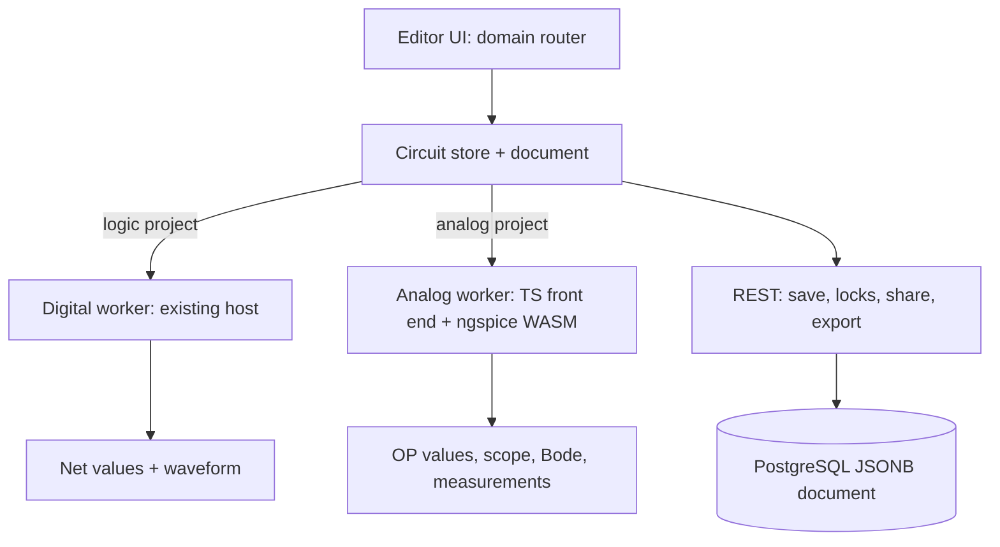
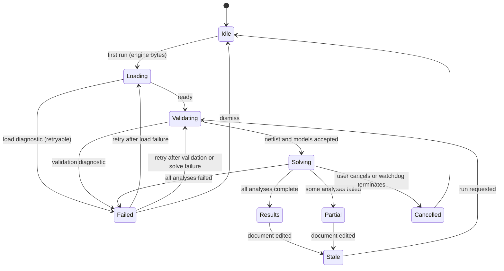
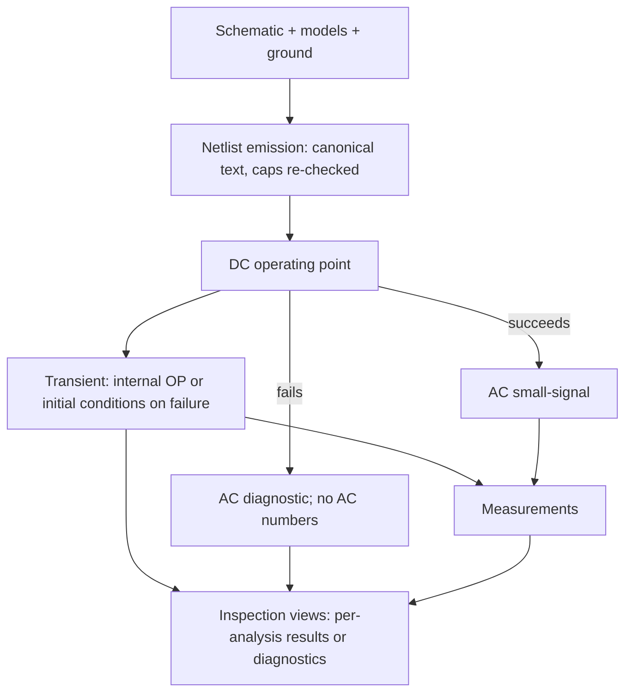
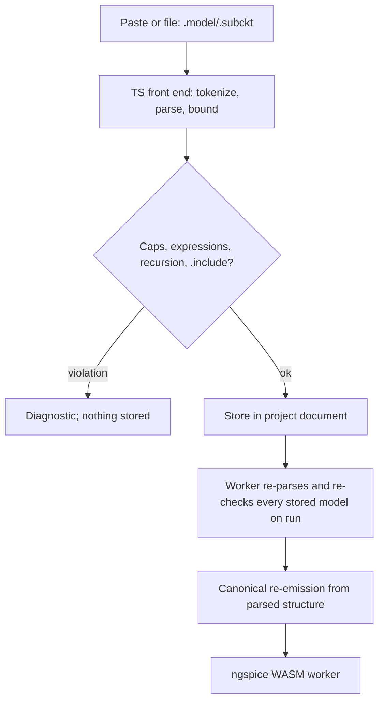

# CircuitGate Analog Lab v1 - Plan

## Goal Capsule

- Objective: A CircuitGate user designs a real analog circuit — sensor front-ends first — and verifies it with simulation results they trust enough to build from, without breadboarding first drafts.
- Means: An analog simulation mode inside CircuitGate — the same editor, projects, teams, and sharing — running continuous-time SPICE-class analyses behind the simulation seam the logic engine already reserves.
- Product authority: The project owner decides scope. This plan owns the analog simulation slice; mixed-signal co-simulation, PCB layout and fabrication, and real-parts/BOM are not active scope.
- Stop conditions: Stop and surface the conflict if implementation evidence invalidates a session-settled decision, or if the acceptance examples cannot be met without changing product scope — do not silently resolve either.
- Execution profile: Solo owner with an implementation agent; test-first for engine behavior per the project's engineering instructions; browser-only, no installation.
- Open blockers: none.

---

## Product Contract

### Summary

Analog simulation becomes a first-class mode of CircuitGate. Users draw real circuits on the existing canvas, run SPICE-class analyses — DC operating point, transient, AC small-signal sweep, and measurements — and inspect trustworthy results in scope, Bode, operating-point, and measurement views, inside the same projects, accounts, teams, and sharing model logic projects use today.

### Problem Frame

Verifying a real circuit today means breadboarding it and working through hand calculations. Both cost time and parts before any reassurance exists, and mistakes surface only after the board is built. The existing CircuitGate logic simulator proved the pattern that matters here — verify on screen before committing to hardware — and the v1 plan explicitly deferred analog simulation to its own brainstorm while naming the logic → analog → PCB roadmap and reserving a seam for a future analog engine (`docs/plans/2026-10-04-1543-feat-circuitgate-logic-v1-plan.md`, Scope Boundaries and Migration Seams).

The owner's stated failure mode is abandonment. The analog slice exists to make design-before-build real for sensor front-ends first, with the collaboration model already in place for teams.

### Key Decisions

- Analog simulation is this slice's active scope; mixed-signal co-simulation, PCB/fabrication, and real-parts/BOM are not. (session-settled: user-directed — chosen over real-parts-first, PCB-first, and end-to-end-first slices: analog is the next step on the accepted logic → analog → PCB roadmap.) Governs R5, R15.
- SPICE-class fidelity with run-then-inspect results. (session-settled: user-directed — chosen over interactive-first idealized components and a pragmatic middle: trustworthy pre-build numbers matter more than instant tweaking.) Governs R6, R7, R8, R9.
- Analog mode staged before mixed-signal. (session-settled: user-directed — chosen over a unified mixed-signal canvas now: the first slice keeps the proven digital engine untouched.) Governs R5.
- Integrated analog lab inside CircuitGate. (session-settled: user-directed — chosen over a narrower verification workbench and a SPICE-interop hub: the owned integrated tool is the point, and it keeps the path to the larger suite.) Governs R11, R12, R13, R14, R15.
- First circuits are analog sensor front-ends; no ADC/MCU interface in this slice. (session-settled: user-directed — chosen over including the digital interface: front-end verification is the immediate need.) Governs R10 and the acceptance focus of AE4.
- The full analysis suite, the full device set, and external model import all land in this slice. (session-settled: user-directed — chosen over slimmer analysis and curated-only device options: maximum real-circuit coverage, accepted with its larger scope.) Governs R2, R3, R6, R14.
- Solver and model failures are explicit: diagnostics, never silent wrong numbers. Governs R9.

<!-- ce-section: work-relationships -->

### How This Work Fits Together

This plan covers the analog simulation slice and the mode that hosts it. The broader breakdown below is the current understanding, not a committed roadmap.

- Logic simulation with accounts, teams, sharing — shipped; see `docs/plans/2026-10-04-1543-feat-circuitgate-logic-v1-plan.md`.
- Analog simulation — this plan. Depends on the project model and simulation seam that shipped with logic; shares the existing accounts, teams, sharing, and lock behavior.
- Mixed-signal co-simulation (analog and logic in one run) — later; depends on this analog engine and the existing digital engine.
- PCB layout and fabrication output — later; can proceed independently once a circuit representation exists, and may reuse the analog device models.
- Real parts, BOM, and sourcing — later; benefits from the device models this plan introduces.
- TKGate/Logisim import and text/HDL entry — still to decide; unaffected by this plan.

### Actors

- A1. Circuit author — the owner first, then students and teammates; designs analog circuits, especially sensor front-ends, and verifies them before building.
- A2. Team member — opens and edits shared analog projects under the existing lock rule.
- A3. Platform operator — maintains the deployed service; unchanged from the logic slice.

### Requirements

**Analog design**

- R1. Users draw analog circuits on the existing schematic canvas using analog components: independent voltage and current sources (DC, sine, pulse, step), resistors, capacitors, inductors, switches, and potentiometers.
- R2. The device set includes signal, LED, and zener diodes, BJTs, MOSFETs, ideal op-amps, and curated real-device models such as 741/TL072-class op-amps, comparators, a 555 timer, and voltage regulators.
- R3. Users import external SPICE device models (`.model`/`.subckt`) and use the imported devices in circuits.
- R4. Analog circuits declare an explicit ground/reference node, and each component's value and model choice are editable.
- R5. A project's domain is explicit: logic or analog. A single simulation run never mixes logic and analog components in this slice.

**Simulation**

- R6. The analog engine runs continuous-time analyses: DC operating point (`.op`), transient (`.tran`), AC small-signal sweep (`.ac`), and measurements (`.meas`: power, RMS, min/max).
- R7. Results are trustworthy: linear-circuit values match analytic expectation and nonlinear devices behave datasheet-typically, within the tolerance recorded in Dependencies / Assumptions.
- R8. Users configure analysis parameters (for example transient duration and step, sweep range and points, measurement definitions) and start or stop analyses; a run is explicit, not delta-cycle stepping.
- R9. Solver and model failures — non-convergence, singular or floating circuits, malformed models — surface actionable diagnostics and never produce silent wrong numbers.
- R10. A sensor-front-end-scale circuit (tens of devices) completes an analysis in seconds in a browser on typical student hardware.

**Inspection**

- R11. Transient results render in a multi-trace viewer covering node voltages and branch currents on a shared time axis.
- R12. AC results render as gain and phase versus frequency.
- R13. Operating-point node voltages and branch currents are inspectable on the schematic and in a results table.
- R14. Measurement results are displayed per configured measurement.

**Product integration**

- R15. Analog projects use the existing projects, accounts, teams, sharing, edit-lock, and save/version behavior unchanged.
- R16. The document schema evolves additively; existing logic projects and their simulation results are unchanged, and export/import round-trips analog circuits.

### Key Flows

- F1. Design and verify an analog circuit
  - **Trigger:** A1 starts a new analog project.
  - **Actors:** A1
  - **Steps:** Place and wire analog components, set values, declare ground, configure an analysis, run it, inspect results, adjust, save.
  - **Covered by:** R1–R14
- F2. Verify a sensor front-end before building
  - **Trigger:** A real board is about to be breadboarded or built.
  - **Actors:** A1
  - **Steps:** Recreate the front-end, run `.op`, `.tran`, `.ac`, and measurements, compare against hand calculations and expected sensor behavior, decide to build or iterate.
  - **Covered by:** R6–R10, R13, R14
- F3. Import a device model and share the project
  - **Trigger:** A circuit needs a vendor part, or a teammate must review the design.
  - **Actors:** A1, A2
  - **Steps:** Import a `.model`/`.subckt`, place the device, simulate; save and share with the team; the teammate opens it under the existing lock.
  - **Covered by:** R3, R15, R16

### Acceptance Examples

- AE1. Operating-point correctness
  - **Covers R6, R7, R13.**
  - **Given:** A resistive divider feeding a BJT bias network, with an explicit ground.
  - **When:** The DC operating point runs.
  - **Then:** Node voltages and branch currents match hand-calculated values within tolerance.
- AE2. Transient fidelity
  - **Covers R6, R7, R11.**
  - **Given:** An RC low-pass driven by a square wave, and a diode clamp.
  - **When:** The transient analysis runs.
  - **Then:** The RC trace matches the analytic exponential and its time constant; the clamp limits at the diode's expected forward drop.
- AE3. AC response
  - **Covers R6, R7, R12.**
  - **Given:** A first-order RC filter.
  - **When:** The AC sweep runs.
  - **Then:** The corner frequency and roll-off match the hand calculation, displayed as gain and phase versus frequency.
- AE4. Multi-sensor front-end
  - **Covers R1, R6, R7, R8, R9, R10, R14, R15, R16.**
  - **Given:** A high-level front-end for multiple sensors — dividers or bridges, amplification, filtering.
  - **When:** Analyses run, the project is exported and imported, and a teammate opens it.
  - **Then:** Measurement results match expected values within tolerance; document structure and analysis setup survive the round-trip and re-running after import reproduces the results; the teammate opens it under the existing lock rule.
- AE5. External model use
  - **Covers R2, R3.**
  - **Given:** An imported vendor op-amp `.subckt`.
  - **When:** It is placed in an amplifier circuit and simulated.
  - **Then:** The circuit runs with the imported model's behavior.
- AE6. Failure surfaced
  - **Covers R4, R9.**
  - **Given:** A circuit with no ground or a floating node, and a malformed imported model.
  - **When:** An analysis is started.
  - **Then:** A clear diagnostic identifies the problem, and no results are silently produced.

### Success Criteria

- The owner stops breadboarding first drafts: a sensor front-end can be checked in the simulator with results close enough to build from.
- A sensor-front-end-scale analysis completes in seconds in the browser.
- A teammate opens a shared analog project and runs it without instructions.
- Existing logic simulation behavior and its end-to-end suite remain unchanged.

### Scope Boundaries

**Deferred for later**

- Mixed-signal co-simulation — analog and logic in one run, covering comparator→logic and MCU/sensor systems.
- PCB layout, routing, and fabrication output (Gerber) — later on the roadmap.
- Real parts, BOM, and sourcing or ordering.
- Full SPICE netlist import/export (LTspice-class interop) and text/HDL circuit entry — only device `.model`/`.subckt` import is in scope.

**Outside this product's identity**

- Desktop or native clients, and offline-first operation — unchanged from the logic slice.
- Real-time simultaneous co-editing — sharing remains access-based with locks.

### Dependencies / Assumptions

- Tolerance assumption: linear-circuit results within 5% of analytic values, nonlinear devices judged against datasheet-typical behavior; planning refines these into concrete acceptance tolerances.
- Sensor front-ends are analog-only in this slice; no ADC/MCU interface (Key Decision 5).
- The v1 stack, persistence model, and collaboration behavior carry over unchanged.
- Browser performance at sensor-front-end scale is achievable with a run-then-inspect model.
- SPICE model import covers a narrow dialect subset — device `.model`/`.subckt` definitions — pending planning.

### Outstanding Questions

- None. The four items previously deferred to planning are resolved in the Planning Contract: the solver approach (KTD1), the model-import dialect (KTD6), analysis defaults and acceptance targets (KTD5), and the analog domain representation (KTD3).

### Sources / Research

- Prior plan and its deferrals: `docs/plans/2026-10-04-1543-feat-circuitgate-logic-v1-plan.md` (analog deferral in Scope Boundaries; roadmap in How This Work Fits Together; engine seam in Migration Seams).
- Simulation seam the analog engine attaches to: `frontend/src/lib/sim/protocol.ts`, `frontend/src/lib/sim/session.ts`.
- Existing engine and document model: `frontend/src/lib/engine/`, `frontend/src/lib/model/circuit.ts`.
- Export/import and persistence: `frontend/src/lib/api/projects.ts`, `backend/src/main/java/dev/circuitgate/project/ProjectDocumentValidator.java`.
- Behavior that must not regress: `frontend/tests/e2e/` (ALU, CPU, latch, oscillator, export round-trip, performance).
- Repo-wide check at brainstorm time: no analog, SPICE, or EDA dependency or code exists today; the deferral statements above are the only footprint.

---

## Planning Contract

Product Contract preservation: unchanged — no R/A/F/AE edits; the four deferred planning questions are resolved here, and the 5% tolerance ceiling in Dependencies / Assumptions stands as the product bar with stricter per-analysis acceptance targets in KTD5.

### Key Technical Decisions

- KTD1. **License-clean ngspice-WASM in a dedicated worker, under a pinned supply chain.** Vendor or build ngspice compiled to WebAssembly with copyleft modules disabled (`KLU`, `tclspice`, `numparam`, `ADMS`, and GPL-licensed XSPICE tables) and with dynamic execution and pthreads off; pin the source tag, patch set, and Emscripten version; ship the artifact as a Vite-imported hashed asset (source under `frontend/src/lib/engine/analog/ngspice/`, emitted under `_app/immutable/`) with a SHA-256 license/provenance manifest and a reproducible build recipe. Cancellation is worker terminate-and-respawn, because a synchronous single-thread solve cannot be cooperatively aborted. The CSP gains `'wasm-unsafe-eval'` in `script-src` — never `'unsafe-eval'` — and an e2e assertion pins that. (session-settled: user-directed — chosen over an in-house TypeScript solver and SpiceSharp via .NET WASM: real SPICE convergence and device-model support matter more than bundle weight.) Instantiates the SPICE-class Product Key Decision; governs R6, R7, R9.
- KTD2. **Two simulation domains behind the existing transport pattern.** The digital protocol, host, worker, and registry stay untouched; analog gets its own versioned protocol, session, and worker entry that copy the command/event conventions and share only `WorkerLike`, the diagnostics store, and the id/correlation invariants. A conformance test holds both protocols to the same invariants. Analog kinds never enter the digital primitive registry, and the analog worker performs no network or storage I/O — message handling and engine calls only. Governs R5, R8, R9.
- KTD3. **Additive document schema, no migration, spread-preserving writes.** An optional top-level `domain` (absent means logic) plus `models` and `analyses` join the document; `schemaVersion` stays 1 and every construction site in the store and API spreads existing fields instead of rebuilding the document — the current rebuild sites silently drop unknown sections and are in scope. Models carry a `formatVersion` now so a future parser or engine change has a migration handle. The backend stays semantics-blind; no server change is needed. This deployment ships client and server together, so an older client silently dropping the new sections is an accepted deploy-coupling assumption, not a supported state. Governs R5, R15, R16.
- KTD4. **Explicit ground, and pin direction as an editor affordance only.** A dedicated one-pin ground component is the reference node, with its single pin declared as an input so device output pins can terminate on it under the store's same-side wiring rule, and it maps to node `0` on import/export; two-terminal devices expose `p1` (input) and `p2` (output) so the existing wiring rules apply. Direction is presentation only: netlist emission reads every pin symmetrically, and a realistic multi-terminal node (op-amp output with feedback and load) is an explicit editor test. Governs R1, R4.
- KTD5. **Numeric acceptance targets, refining the Product Contract's 5% ceiling.** Linear `.op` node voltages within 1% of analytic values; nonlinear `.op` bias values (BJT/MOSFET node voltages and branch currents) within 5% of hand calculation for the fixture model cards; transient sampled values within 2% and time constants within 2%; AC corner frequency within 2% and magnitude within 0.5 dB; nonlinear device behavior checked against datasheet-typical ranges (for example, diode forward drop 0.6–0.8 V at rated current). Default analysis parameters ship editable with the form: transient 1 ms span with a 1 µs maximum step; AC 10 Hz to 1 MHz at 20 points per decade. A shared tolerance helper backs engine and end-to-end assertions. Governs R6, R7.
- KTD6. **Own TypeScript front end, re-validated on every run.** Device `.model` and `.subckt` definitions only; `.include`/`.lib` rejected with an explicit diagnostic; expression functions whitelisted; per-model size, nesting depth, node, parameter, and expanded-instance caps enforced; recursion and include cycles rejected. Because the license-clean engine build excludes `numparam`, `.param` definitions and brace expressions are evaluated in the TypeScript front end, and every emitted token — not only identifiers — is re-serialized from parsed values, so raw imported text and injected whitespace or directives cannot reach the deck. Because documents arrive through save, import, and sharing, the worker repeats the parse and all caps on every run, not just at import. Imported models are stored in the project document, each within the existing 10,000-character string limit. Governs R3, R9.
- KTD7. **Analysis setup persists; results do not.** Analysis configuration round-trips with save, export, and share; traces and tables are recomputed on demand, so a shared project reproduces by re-running rather than replaying stored results. Governs R8, R16.
- KTD8. **No silent floating-node repair, and per-analysis failure.** Nodes with no DC path produce a diagnostic and no results instead of an automatic pull-down that changes behavior; AC requires a successful operating point, while transient uses the solver's internal operating point or user initial conditions and reports an operating-point failure as its own diagnostic. Each analysis fails independently and no partial numbers are presented as complete; users add explicit path resistors for DC paths. Governs R4, R9.
- KTD9. **Lazy-loaded engine asset with a load contract.** The worker is constructed on the first analog run, never on project open, and the engine bytes load inside that run — document edits invalidate results and re-send the document without terminating the worker. The payload budget is 40 MB decoded and 12 MB over the wire, served precompressed with immutable caching from its content-hashed URL, so an engine update always lands on a new URL; loading shows progress, failure surfaces a retryable diagnostic, worker heap is capped with an out-of-memory diagnostic and respawn, and one worker per open page is disposed on project or domain switch and after an idle timeout. Results transfer to a main-thread results store at run completion and the worker stays compute-only, so disposal never loses retained results. Governs R10.
- KTD10. **Minimal domain-aware UI split.** A domain router mounts exactly one simulation panel — analog or digital — and the digital panel's behavior and tests stay as they are. No general simulation-layer refactor rides along. Governs R15.
- KTD11. **Curated IC models ship with the app.** 741/TL072-class op-amps, a comparator, a 555 timer, and a regulator macromodel are versioned static assets with a provenance manifest recording source, license, redistribution terms, and SHA-256, available offline and deterministic across sessions. Governs R2.

### High-Level Technical Design

Domain routing — the digital engine remains on its existing path; analog is a parallel surface:

Analog run lifecycle — loading, per-analysis outcomes, cancellation, and stale-on-edit are all explicit:

Analysis pipeline — the operating point gates AC, while transient falls back to the solver's internal operating point or initial conditions; every analysis has its own diagnostics:

Model import and stored-model re-validation — untrusted text is bounded at import and again on every run, and only canonical text reaches the engine:

### Alternatives Considered

- In-house TypeScript solver — rejected: reaching SPICE-class convergence and vendor-model compatibility from scratch is the highest-risk path against the project's abandonment failure mode; a permissive solver could return later as a light-circuit fallback.
- SpiceSharp via .NET WASM — rejected for now: MIT-licensed and mature-ish, but adds a .NET WASM runtime and toolchain with less proven device-model coverage than ngspice.
- Server-side ngspice — rejected: untrusted imported models executing on the shared self-hosted backend is a denial-of-service risk, and browser-side solving is the market norm.
- Interactive idealized simulator — rejected upstream in the brainstorm: cannot meet the SPICE-class fidelity decision.

### Sequencing

Implementation order: U1 → U2 → U3 → U5 → U6 → U4 → U7 → U8, with U3 running parallel to U1/U2. U-IDs are stable and remain listed numerically below.

### Risks & Dependencies

- License compliance of the WASM build is the highest-risk item; U1 gates it with a hash-pinned provenance manifest, disabled copyleft modules, and accuracy measurements. If the spike cannot produce a compliant, accurate artifact, stop and revisit KTD1 with the user.
- CSP cost: `'wasm-unsafe-eval'` weakens script-injection defense-in-depth for any same-origin script; accepted only because the app is self-hosted, nonce-based, and never adds `'unsafe-eval'` — the e2e assertion pins that.
- Engine payload and serving: 40 MB decoded / 12 MB wire depends on precompressed serving and immutable caching; U1 records raw, wire, compile, instantiate, cold and warm run times, and worker RSS.
- Synchronous solver: cancellation is worker terminate-and-respawn with its recorded reload cost, and solve progress depends on engine callbacks that must be proven available in the single-threaded build; U1 establishes both mechanisms before U2, and U6 degrades the progress surface to an indeterminate state if callbacks cannot be proven.
- Convergence UX: "timestep too small" and singular circuits are common failure modes; KTD8 and U6 own the diagnostics path, and parameter caps plus a watchdog keep a hostile or pathological analysis from hanging the tab.
- Imported-model abuse: bounds, canonical re-emission, and per-run re-validation in KTD6; hostile-input and hostile-document scenarios in U8. Expanded subcircuit fan-out is capped separately from depth.
- Document limits: models are capped at the existing 10,000-character global string limit rather than raising it; the backend remains semantics-blind, and larger vendor models are unsupported in this slice.
- Deploy coupling: an older deployed client would silently drop the new sections; acceptable because client and server ship together, and recorded as an assumption rather than a supported state.
- Scope vs. a solo builder: eight units with an early go/no-go gate (U1) and an end-to-end path (U3 → U5 → U6 → U7); phases allow stopping at a useful checkpoint.

### Documentation / Operational Notes

- README gains an analog simulation section (domain model, analyses, device library); `docs/operations.md` gains the WASM asset and document-limit configuration notes.
- The engine build recipe and license manifest live with the vendored artifact; CI validates the manifest and the payload budget.
- A repo script `frontend/scripts/check-analog-wasm.mjs` verifies manifest presence and payload size, and is wired into `.github/workflows/ci.yml`.

---

## Implementation Units

### U1. License-clean ngspice-WASM engine spike

- **Goal:** Produce a hash-pinned, license-clean ngspice WASM artifact with a proven browser harness, and prove SPICE-class accuracy, progress/cancel mechanism, CSP compatibility, and budget before anything is built on it.
- **Requirements:** R6, R7; de-risks R10 (KTD1, KTD5, KTD9).
- **Dependencies:** none.
- **Files:** `frontend/src/lib/engine/analog/ngspice/` (artifact source and hash/provenance manifest), `frontend/scripts/check-analog-wasm.mjs`, `.github/workflows/ci.yml`, `frontend/src/lib/engine/analog/tolerance.ts`, `frontend/tests/fixtures/analog-spike/` (reference circuits owned by this unit, including a parameterized vendor-style `.subckt`), `frontend/src/lib/engine/analog/__tests__/spike.test.ts`, `frontend/tests/e2e/analog-engine-spike.spec.ts`, `docs/operations.md` (build recipe, harness decision).
- **Approach:** Build or vendor ngspice via Emscripten with `KLU`, `tclspice`, `numparam`, `ADMS`, GPL XSPICE tables, dynamic execution, and pthreads disabled. Record the harness decision explicitly: the current vitest project is Node-only with no browser mode, so accuracy may run under a Node-compatible Emscripten build loaded from disk, while browser conditions (CSP, progress, cancel, load timing) are proven by a Playwright spec against the built app. Prove whether engine callbacks expose progress in the single-threaded build, and record terminate-and-respawn as the cancel mechanism with its reload cost. Introduce the shared tolerance helper KTD5 defines, and wire the manifest/budget CI check.
- **Execution note:** Go/no-go gate. If a compliant artifact cannot be built, the harness cannot prove progress/cancel in a real browser, or accuracy/budget targets miss, stop and surface KTD1 before U2 starts.
- **Patterns to follow:** colocated vitest conventions in `frontend/src/lib/engine/__tests__`; the Playwright production-build setup in `frontend/playwright.config.ts`; recipe conventions in `docs/operations.md`.
- **Test scenarios:**
  - Divider `.op` on 12 V across equal 10k resistors returns 6.0 V within 1%.
  - RC low-pass (1k, 100 nF) `.ac` corner at 1.59 kHz within 2%, with a −20 dB/decade slope.
  - RC `.tran` square wave: time constant 100 µs within 2% and sampled values within 2% of the analytic exponential.
  - Diode clamp limits within the datasheet-typical forward-drop range.
  - BJT bias stage collector current and collector voltage match hand calculation within 2% for the fixture model card.
  - Curated-model proof uses a minimal op-amp subcircuit fixture local to this unit — no dependency on the U5 library.
  - Browser proof: an analog run succeeds under the production build's CSP with `'wasm-unsafe-eval'` present and `'unsafe-eval'` absent.
  - Mechanism proof: a long transient emits progress at ≤10 Hz if callbacks are available (otherwise record progress as indeterminate for U6), and cancel terminates the worker immediately with the next run usable within the cold-run budget.
  - Budget proof: raw ≤ 40 MB, wire ≤ 12 MB over precompressed serving, cold first run ≤ 10 s on the reference machine; compile, instantiate, warm runs, and worker RSS high-water recorded; the emitted asset URL is content-hashed and served with an immutable cache header.
  - A parameterized vendor-style `.subckt` using `.param` and brace expressions parses through the front end, re-emits resolved canonical text, and simulates with correct values.
  - Manifest records source tag, patch set, Emscripten version, component licenses, and SHA-256 per artifact; the CI script recomputes hashes and fails on mismatch.
- **Verification:** Spike tests pass; manifest and recipe committed; recorded numbers meet KTD5 and budget targets.

### U2. Analog session protocol and worker

- **Goal:** A versioned analog simulation protocol and worker session with cancellation, bounded progress, diagnostics, and typed-array result envelopes, sharing transport invariants with the digital protocol.
- **Requirements:** R8, R9, R10 (KTD2, KTD9).
- **Dependencies:** U1.
- **Files:** `frontend/src/lib/sim/analog/protocol.ts`, `frontend/src/lib/sim/analog/session.ts`, `frontend/src/lib/sim/analog/__tests__/protocol.test.ts`, `frontend/src/lib/sim/analog/__tests__/conformance.test.ts`, `frontend/src/lib/sim/__tests__/fakeWorker.ts` (shared harness extracted from the current private test helpers), `frontend/src/workers/analog.worker.ts`.
- **Approach:** Copy the digital transport conventions — monotonic command ids, correlation ids on responses, unsolicited status/progress/diagnostic events, strict protocol-version check, worker respawn on crash — and share only `WorkerLike`, the diagnostics store, and the id/version invariants. Commands: initialize, run (analysis set), cancel, dispose. Events: ready, progress, result per analysis, diagnostic, restarted; `restarted` is followed by progress or a diagnostic before `ready`. The worker loads the engine inside the run handler (never on initialize), reads cancel through the mechanism U1 proved, coalesces progress to ≤10 Hz, caps its heap, and performs no network or storage I/O. Results cross the boundary as typed arrays, not ASCII, and ownership transfers to the main-thread results store at completion so the worker stays compute-only and disposable (KTD9).
- **Execution note:** Implement test-first at the protocol layer using the extracted fake-worker harness.
- **Patterns to follow:** `frontend/src/lib/sim/protocol.ts`, `frontend/src/lib/sim/session.ts`, `frontend/src/workers/engine.worker.ts`, `frontend/src/lib/sim/diagnostics.ts`.
- **Test scenarios:**
  - Command id and correlation invariants hold, and a shared conformance suite passes for both the digital and analog protocols.
  - Protocol version mismatch yields an `unsupported-protocol` diagnostic and no run.
  - Cancel mid-run terminates the worker immediately, yields a cancelled event and no result event, and the next run is usable within the cold-run budget.
  - A watchdog terminates and respawns the worker when a solve exceeds its deadline without progress, surfacing an out-of-memory or timeout diagnostic.
  - Worker crash yields `restarted` followed by ready; the session can run again.
  - Progress events are coalesced to ≤10 Hz over a long transient run.
  - Result payloads are typed arrays; no ASCII result path is used above the stub threshold.
- **Verification:** Analog protocol and conformance suites green; digital protocol suite untouched and green.

### U3. Document domain, models, analyses, and persistence round-trip

- **Goal:** The additive document schema works end-to-end — domain marker, model store, and analysis configuration — preserved by every load, validate, mutate, save, and export path, with existing logic documents unchanged.
- **Requirements:** R5, R15, R16 (KTD3, KTD7).
- **Dependencies:** none (runs parallel to U1/U2).
- **Files:** `frontend/src/lib/model/circuit.ts`, `frontend/src/lib/model/schema.ts`, `frontend/src/lib/api/projects.ts`, `frontend/src/lib/state/circuitStore.ts`, `frontend/src/lib/state/selection.ts`, `frontend/src/lib/model/__tests__/schema.test.ts`, `frontend/src/lib/state/__tests__/document-preservation.test.ts`, `frontend/tests/fixtures/analog-divider-project.json`, `frontend/tests/fixtures/analog-rc-project.json`, `frontend/tests/e2e/analog-export-import.spec.ts`, `backend/src/test/java/dev/circuitgate/project/AnalogDocumentAcceptanceTest.java`, `docs/operations.md` (document-limit notes).
- **Approach:** Add optional `domain`, `models`, and `analyses` to the document type, the store options, the editor snapshot, and `emptyProjectDocument`, with each model carrying a `formatVersion` and staying within the existing 10,000-character string limit (no backend config change). Every construction site is in scope and must spread existing fields instead of rebuilding the document — specifically `toProjectDocument` and `validateProjectDocument` in the projects API, and the store's component, pin-net, net-merge, replace-component, and definition-save mutation paths. Align client depth validation with the backend's depth limit so nested model structures cannot pass the client and fail the server. The export envelope and schema version are unchanged.
- **Test scenarios:**
  - Existing logic fixtures validate, save, and export with unchanged structure and simulation results; absent domain behaves as logic.
  - An analog document with domain, two models, and analysis configs round-trips through save, load, export, and import unchanged.
  - Mutation-level preservation: placing a component, setting a pin net, merging nets, deleting a component through the selection module, and saving a definition each preserve domain, models, and analyses — tested at the store level, not only through the API helper.
  - Unknown future document sections survive a load/mutate/save cycle — no silent stripping.
  - Nested structures beyond the backend depth limit are rejected client-side before save; oversized model entries are rejected with a diagnostic.
  - A backend integration test (MockMvc) accepts an analog document within limits and still rejects over-limit payloads.
- **Verification:** Unit, store-preservation, and e2e round-trip suites green; logic fixture behavior unchanged.

### U4. Domain entry points, routing, and collaboration behavior

- **Goal:** Users can create or import an analog project, the editor selects the analog surface, and read-only and lock rules cover models, analysis edits, and imports.
- **Requirements:** R15, R16; F1, F3; A1, A2; AE4 (KTD10).
- **Dependencies:** U3, U5, U6.
- **Files:** `frontend/src/routes/(app)/projects/+page.svelte`, `frontend/src/routes/(app)/projects/[id]/+page.svelte`, `frontend/src/lib/components/sim/SimulationPanel.svelte`, `frontend/src/lib/state/circuitStore.ts`, `frontend/tests/e2e/analog-project-lifecycle.spec.ts`.
- **Approach:** Offer a domain choice at project creation and import, defaulting absent to logic; the domain router mounts exactly one simulation panel — analog or digital — and never keeps both alive; allow running on read-only projects while model import and analysis edits require the edit lock; ensure dirty-save, save-as-copy, and lock-conflict paths preserve models and analyses; dispose the analog worker on project or domain switch.
- **Test scenarios:**
  - Creating an analog project opens the analog surface; creating a logic project keeps today's digital behavior.
  - AE4: the multi-sensor front-end runs, measurement results match expected values within KTD5 tolerance, and then export/import and the teammate-open lock check follow.
  - Importing an exported analog project restores domain, models, and analyses.
  - A read-only teammate can run analyses; import is unavailable and analysis edits are blocked.
  - A lock conflict with a dirty analog project preserves the draft model and analysis state through export or save-as-copy.
- **Verification:** E2e lifecycle suite green; digital e2e specs unchanged and green.

### U5. Analog device kinds, curated models, and domain-filtered registry

- **Goal:** Analog components are placeable and wireable with editable values and defined pin conventions, and the palette and inspector never offer cross-domain kinds.
- **Requirements:** R1, R2, R4; F1 (KTD4, KTD11).
- **Dependencies:** U3.
- **Files:** `frontend/src/lib/engine/analog/primitives.ts`, `frontend/src/lib/engine/analog/models/` (curated assets and provenance manifest), `frontend/src/lib/engine/analog/__tests__/kinds.test.ts`, `frontend/src/lib/components/editor/Palette.svelte`, `frontend/src/lib/components/editor/Inspector.svelte`, `frontend/src/lib/render/scene.ts`, `frontend/src/lib/state/circuitStore.ts`, `README.md` (analog section), `frontend/tests/e2e/analog-editor.spec.ts`.
- **Approach:** Registry entries declare their domain, and analog kinds never enter the digital primitive registry — a shared kind resolver feeds the store, scene, and inspector so filtering is one invariant, not three copies. Palette groups filter by the project domain; inspector kind conversion refuses cross-domain changes and surfaces a domain-mismatch error; the store's existing pin-net-dropping behavior on kind change is guarded by that refusal. Ground is single-pin with its pin declared as an input so device output pins can terminate on it; two-terminal devices expose `p1` (input) and `p2` (output) as an editor affordance only (KTD4). Model-backed devices expose a Model selector in the inspector listing curated and imported models valid for the device class, seeded with a placement default, with a diagnostic for missing or invalid references. Value entry parses SI suffixes unambiguously (`meg` versus `m`). Subcircuit packaging stays logic-only in this slice; imported models are the analog reuse path. No curated asset ships unless its recorded provenance terms permit redistribution in the application bundle; models lacking such terms are replaced by in-house macromodels before this unit completes. The canvas keeps the existing generic component rendering with analog value labels — device glyphs are deferred polish.
- **Test scenarios:**
  - Every listed kind places, wires, and deletes; two-terminal wiring works from either side.
  - SI parsing maps `10k` to 10000, `1meg` to 1e6, `1m` to 1e-3, and rejects invalid values.
  - A logic project's palette offers no analog kinds and vice versa; converting a logic kind to an analog kind is refused with a domain-mismatch error and no silent pin loss.
  - Analog kinds are absent from the digital primitive registry, so the digital compile path cannot accept them.
  - An op-amp output node with feedback and a load (a realistic multi-terminal net) wires and netlists correctly.
  - Curated op-amp, comparator, 555, and regulator models instantiate; a missing ground is caught by run validation (U6), not editor placement.
  - Switching a placed op-amp between two curated models, and assigning a freshly imported `.subckt` to a placed device, both update the simulation netlist.
  - Curated assets match their provenance manifest (source, license, redistribution terms, hash) and load deterministically offline; an asset whose terms do not permit bundling fails the manifest check and is replaced.
- **Verification:** Unit and e2e editor suites green; no digital palette, inspector, or registry behavior change.

### U6. Analysis configuration, run lifecycle, and diagnostics

- **Goal:** Configure the analyses, run and cancel with progress, see failures as actionable diagnostics, and never see stale or partial numbers presented as current.
- **Requirements:** R8, R9; F2, AE6 (KTD5, KTD8).
- **Dependencies:** U2, U5.
- **Files:** `frontend/src/lib/components/sim/analog/AnalysisPanel.svelte`, `frontend/src/lib/sim/analog/diagnostics.ts`, `frontend/src/lib/components/sim/Diagnostics.svelte`, `frontend/src/lib/sim/analog/__tests__/diagnostics.test.ts`, `frontend/tests/e2e/analog-run-lifecycle.spec.ts`, `frontend/tests/e2e/analog-diagnostics.spec.ts`.
- **Approach:** An analysis form covers operating point, transient parameters, AC sweep, and measurement definitions, with enforced parameter caps (maximum points, internal steps, duration-to-step ratio) so a hostile or accidental configuration cannot hang the tab; KTD5's defaults seed the form. Runs follow the pipeline in High-Level Technical Design (AC requires a successful operating point; transient uses the solver's internal operating point or initial conditions when the operating point fails); each analysis fails independently and partial runs render per-analysis results beside per-analysis diagnostics, never as complete numbers. Analog controls are Run and Cancel only — no Pause, Step, or Reset; a progress indicator fed by the coalesced progress events shows the current analysis (indeterminate when engine callbacks are unavailable); the loading state shows engine-bytes progress with Cancel, and Failed renders Retry and Dismiss, with net-scoped diagnostics gaining a locate action alongside the existing component action. Document edits retain the last results under a persistent stale banner with a re-run action rather than clearing them. Each measurement definition carries a name, a type (power, RMS, min/max), a signal target chosen from placed nets and branch currents, and an optional window; the editor supports add/remove/duplicate with inline validation and a diagnostic for definitions that cannot bind. Netlist emission runs a DC-path connectivity check that names nodes with no path to ground and suppresses that analysis's results rather than relying on engine fallbacks. The U2 watchdog covers a non-responding solve, and the shared diagnostics component keeps its digital rendering paths untouched — the digital suite must stay green.
- **Test scenarios:**
  - Each analysis configures and runs with visible progress and results; the form seeds KTD5 defaults.
  - Cancel mid-run shows cancelled and never presents partial results as final.
  - A circuit without ground yields a diagnostic naming the affected net and no numbers (AE6); a capacitor-isolated node with no DC path yields the floating-net diagnostic and no numbers for that analysis.
  - A non-convergent circuit yields a convergence diagnostic with guidance; transient may still produce results under initial conditions, and that state is labeled.
  - An AC run without a successful operating point yields an AC-only diagnostic and no AC numbers while transient results remain visible.
  - Analysis parameters beyond the caps are rejected with a diagnostic before the solver starts.
  - First run shows engine-bytes progress with Cancel; Failed shows Retry and Dismiss, and retrying a load failure re-enters loading.
  - Editing the document after a run keeps the last results under a stale banner with a re-run action rather than clearing them.
  - A measurement definition with name, type, and target round-trips, runs, and renders; a definition that cannot bind produces a diagnostic.
- **Verification:** E2e run-lifecycle and diagnostics suites green; every failure path renders a diagnostic and no partial numbers present as complete.

### U7. Inspection views

- **Goal:** Transient traces, AC gain and phase, operating-point values on the schematic and in a table, and measurement results are all inspectable.
- **Requirements:** R11, R12, R13, R14; AE1, AE2, AE3.
- **Dependencies:** U6.
- **Files:** `frontend/src/lib/components/sim/analog/ScopeView.svelte`, `frontend/src/lib/components/sim/analog/BodeView.svelte`, `frontend/src/lib/components/sim/analog/OperatingPointPanel.svelte`, `frontend/src/lib/components/sim/analog/MeasurementResults.svelte`, `frontend/src/lib/components/editor/Canvas.svelte`, `frontend/tests/fixtures/analog-results/` (recorded result fixtures with a documented shape), `frontend/tests/e2e/analog-inspection.spec.ts`, `frontend/tests/e2e/analog-performance.spec.ts`.
- **Approach:** The analog lab composes as an analysis-configuration pane beside a tabbed result area — Scope, Bode, Operating point, Measurements — defaulting to the tab of the analysis just completed, with a per-tab empty state and per-analysis diagnostics placed with their analysis; the shared diagnostics list renders above the tabs. Each tab shows a multi-trace scope with a shared time axis for transient, gain/phase versus frequency for AC, operating-point values as canvas annotations plus a table, and measurement results per configured measurement. Result handling is a three-stage policy: the transient output uses the solver's uniform output grid, the worker retains the full run up to an explicit point cap, and the view decimates with min/max buckets at roughly two samples per pixel; zoom resolves within retained detail, and beyond the cap the plan states the bound rather than implying full resolution. All four views render the shared stale treatment from U6. Result fixtures let the views render without the engine.
- **Test scenarios:**
  - AE1: divider with BJT bias operating point matches hand calculation within KTD5 tolerance, visible on canvas and in the table.
  - AE2: RC low-pass plus clamp transient shows the expected shape and time constant across two traces, preserved under view decimation.
  - AE3: first-order filter AC shows the expected corner and roll-off in the Bode view.
  - A configured measurement renders in the results view.
  - A million-point, eight-trace transient renders from the retained cap with pan and zoom at ≥30 fps and a first render ≤100 ms, using min/max buckets, and states whether deep zoom reaches full detail or the cap.
  - Views render from result fixtures alone, with no engine dependency.
  - After a run, the tab for the most recently completed analysis is active; before any run each tab renders its empty state.
  - After a document edit, every result tab shows the stale treatment and the re-run action.
- **Verification:** E2e inspection suite green; fixture rendering green; decimation preserves min/max peaks in the AE2 check.

### U8. SPICE model import

- **Goal:** Import `.model`/`.subckt` definitions safely and use the imported devices in circuits.
- **Requirements:** R3, R4; F3, AE5, AE6 (KTD6).
- **Dependencies:** U3, U5, U6.
- **Files:** `frontend/src/lib/engine/analog/parser/` (tokenizer, parser, bounds), `frontend/src/lib/engine/analog/parser/__tests__/parser.test.ts`, `frontend/src/lib/engine/analog/__tests__/canonical.test.ts`, editor import control in `frontend/src/routes/(app)/projects/[id]/+page.svelte`, `frontend/tests/e2e/analog-model-import.spec.ts`.
- **Approach:** Own TypeScript front end for the defined subset — continuation lines, comments, case-insensitivity, SI suffixes; reject `.include`/`.lib` with an explicit unsupported diagnostic; enforce per-model size (within the existing 10,000-character limit), nesting depth, node, parameter, and expanded-instance caps; whitelist expression functions; reject recursion and include cycles before engine handoff (reuse the definition-cycle approach in `frontend/src/lib/engine/hierarchy.ts`). The engine receives only canonical text re-emitted from the parsed structure, with identifiers restricted to a safe charset, so no stored name can synthesize a deck directive. Because documents also arrive via save, import, and sharing, the worker repeats parsing and every cap on each run; a hand-crafted project with a hostile stored model opens with a diagnostic and never reaches the engine. Use character scanners with bounded line/token lengths rather than backtracking-prone patterns.
- **Execution note:** Implement the parser, canonical re-emission, and rejection paths test-first with hostile inputs.
- **Test scenarios:**
  - A vendor-style `.subckt` op-amp with continuations and comments parses, instantiates, and simulates (AE5).
  - A malformed model yields an actionable diagnostic and stores nothing (AE6).
  - `.include` and `.lib` references are rejected with an explicit unsupported diagnostic, including split-token and continuation-line variants.
  - A node or instance name containing a newline plus a directive (for example `.control`) is rejected or neutralized by the charset rule and never appears in the emitted deck.
  - Self-recursive, over-depth nested, and over-fan-out definitions (nested instantiation explosion just over the expanded-instance cap) are rejected.
  - Oversized model text and a pathological single-line input are rejected or bounded without stalling the parser.
  - A hand-crafted hostile project document, loaded directly rather than through the import UI, is caught by the worker's per-run re-validation and never reaches the engine.
  - A model whose name contains markup round-trips and renders inert in diagnostics, palette, and inspector.
  - An imported model survives save, export, import, and reload, and still simulates.
- **Verification:** Parser, canonical re-emission, and e2e import suites green; hostile inputs and hostile documents never reach the engine.

---

## Verification Contract

| Gate | Command | Applies to |
|---|---|---|
| Frontend types and lint | `cd frontend && bun run check` | all frontend units |
| Frontend unit tests | `cd frontend && bun run test` | engine, protocol, model, parser, store-preservation units |
| Engine numeric accuracy | `cd frontend && bun run test -- src/lib/engine/analog` | U1, U2, U8 |
| Protocol conformance | `cd frontend && bun run test -- src/lib/sim/analog` | U2 (shared invariants with the digital protocol) |
| Frontend end-to-end | `cd frontend && bun run test:e2e` | U1 browser proof and U3–U8 acceptance examples |
| Backend build and tests | `cd backend && ./mvnw --batch-mode --no-transfer-progress verify` | U3 document acceptance |
| WASM manifest and budget | `node frontend/scripts/check-analog-wasm.mjs` | U1 hash, raw ≤ 40 MB, wire ≤ 12 MB; wired into `.github/workflows/ci.yml` |
| Analog performance fixture | `cd frontend && bun run test:e2e -- analog-performance` | U7 and Definition of Done thresholds |
| CI | `.github/workflows/ci.yml` | all of the above on every push |

Performance thresholds on the reference machine (fixed fixture, sensor-front-end scale): cold first run (load plus solve plus first render) ≤ 10 s; warm `.op` ≤ 0.5 s; warm `.tran` ≤ 2 s; AC sweep of 100 points ≤ 1 s. The CI ceiling is generous; the recorded numbers are the baseline.

CSP assertion: the production-build e2e verifies `'wasm-unsafe-eval'` present and `'unsafe-eval'` absent in `script-src`, alongside the existing security-header checks.

Acceptance trace: AE1–AE3 are proven in U7's numeric assertions and inspection e2e; AE4 in U3/U4 round-trip and sharing e2e; AE5 and AE6 in U8, with the no-ground and non-convergence paths also covered in U6.

---

## Definition of Done

Global criteria:

- All eight units complete; every unit's Verification satisfied and its test scenarios implemented.
- Acceptance examples AE1–AE6 pass as automated tests within KTD5 tolerances.
- Existing logic unit and end-to-end suites pass unchanged.
- The vendored engine ships with a hash-pinned provenance manifest and build recipe; raw payload ≤ 40 MB and wire ≤ 12 MB; the CI manifest/budget check passes; the CSP e2e assertion passes.
- Performance thresholds met on the reference fixture: cold first run ≤ 10 s; warm `.op` ≤ 0.5 s; warm `.tran` ≤ 2 s; AC 100 points ≤ 1 s.
- Hostile stored models are caught by per-run re-validation and never reach the engine; no partial analysis presents as complete.
- Documentation updated: README analog section, operations notes for the engine asset, serving/caching, document limits, and the harness decision.
- Cleanup: spike and experimental code is removed or promoted; no abandoned-branch leftovers in the diff.

Per-unit completion is the unit's own Verification line plus its test scenarios; a unit is not done while any scenario is unimplemented or failing.
