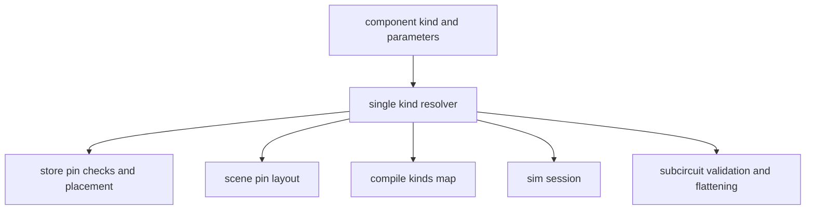
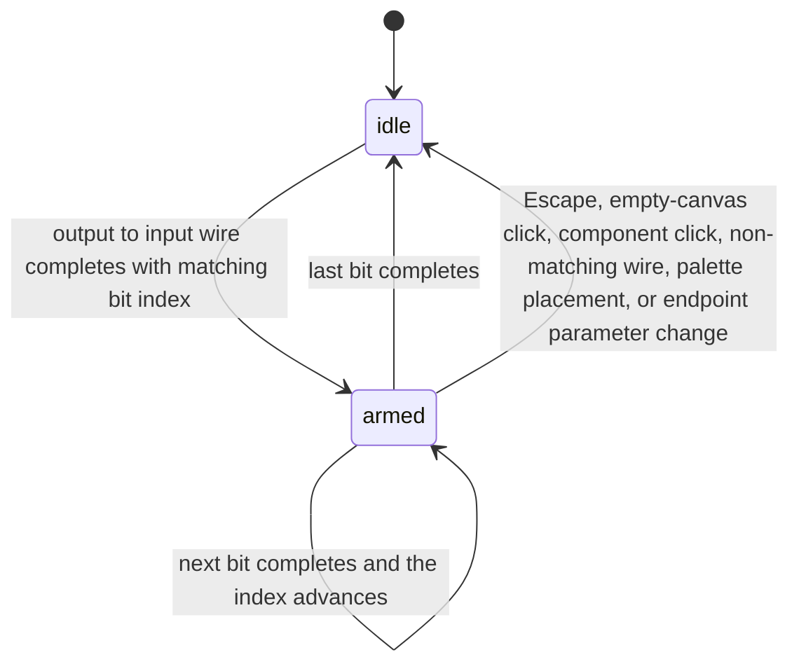

# CircuitGate Parameterized Logic Nodes - Plan

## Goal Capsule

- Objective: A student building ALU/CPU-scale logic designs can place, wire, and simulate ripple adders, comparators, registers, register files, ROM, and RAM at 1–32 bits in the CircuitGate logic editor — no hand-built register stacks, no unreachable engine primitives.
- Means: Complete the parameterized-kind seam so a component's kind and parameters drive its pins and behavior in the editor, canvas, and simulation; wiring stays pin-to-pin with an index-matched assist that advances through a word.
- Product authority: The project owner decides scope. This plan owns the parameterized logic nodes slice; the other node areas from the opening survey (digital displays/buses, analog device breadth, mixed-signal bridges, analog subcircuit packaging) are not active scope.
- Open blockers: None.
- Execution profile: Solo owner with an implementation agent; test-first for engine behavior per the project's engineering instructions; browser-only.

---

## Product Contract

### Summary

The six parameterized logic families — ripple adders, comparators, registers, register files, ROM, and RAM — become placeable, wireable, and simulatable at 1–32 bits, closing the gap between what the engine ships and what the palette offers. Widths and memory contents are component parameters edited in the Inspector; wiring stays pin-to-pin with an index-matched assist that advances through a word.

### Problem Frame

The logic v1 plan's R8 requires ROM, RAM, and register-file primitives for CPU-scale designs, and `PRODUCT.md` lists them (with adders) as logic capabilities — but none of the six parameterized families can be placed. The palette omits them, the registry, scene, and simulation resolve only static kinds, and the engine factories have no callers outside their tests. A student needing a register file or memory today must build it bit-by-bit from flip-flops or cannot build it at all, and wide adders and comparators are equally unreachable. The usability bar is 16–32 bits, where the one-pin-per-bit engine makes a single node 33+ pins — placement alone would not make these nodes usable, which is why the wiring experience is part of this work rather than a follow-up.

### Requirements

**Placement and configuration**

- R1. All six parameterized families are placeable from the logic palette with sensible default widths.
- R2. A component's parameters (width, word width, address width, contents) determine its pins and behavior in the editor, canvas, and simulation; changing a parameter updates the component while keeping connections on surviving pins.
- R3. Width is editable from 1 to 32 in the Inspector; ROM depth derives from its contents; RAM and register file expose address width and word width as separate parameters.

**Wiring**

- R4. Wiring stays pin-to-pin; when the user connects matching bit positions of two wide nodes, the assist arms the next bit in order, so a 16–32-bit connection does not require hunting each pin.
- R5. The assist never alters ordinary wiring: mismatched or single-pin connections behave exactly as today; Escape or an empty-canvas click cancels an armed assist.
- R6. Wide nodes keep individual, labeled pins visible; no bus abstraction is introduced and the engine remains one net per bit.

**Simulation and compatibility**

- R7. All six families simulate correctly at their configured widths: ROM returns initialized contents, RAM writes then reads across cycles, register file supports two reads and one write per cycle, and adders and comparators compute at width.
- R8. Documents without parameterized kinds load, simulate, and save unchanged; parameterized components round-trip through save/load and export/import.

### Key Decisions

- Dynamic resolution from kind and parameters (session-settled: user-approved — chosen over a fixed catalog and subcircuit composition: one seam serves all six families and reuses the factory tests and the half-built width UI). Governs R1, R2, R7.
- Assisted stepping as the wiring shape (session-settled: user-directed — chosen over bus-style ports, ribbon drag, and the manual baseline: keeps pin-to-pin as the gesture). Governs R4, R6.
- Index-matched, always-on assist trigger (session-settled: user-approved — chosen over an armed toggle and unconditional assist: assists word wiring without changing ordinary connections). Governs R4, R5.
- All six families in scope (session-settled: user-approved — chosen over R8-trio-only, memories-only, and registers-only: one seam serves all, and `PRODUCT.md` already claims adders). Governs R1.
- Memory configuration rides the existing parameter editing, with ROM contents edited as raw JSON (inferred — smallest surface that meets the initialized-ROM acceptance; revisit if a table editor is wanted later). Governs R3, R7.

### Key Flows

- F1. Place and configure a wide node.
  - **Trigger:** The user picks a parameterized family from the palette.
  - **Steps:** Place the node, select it, set width or contents in the Inspector; pins re-derive and surviving wires stay connected.
  - **Covered by:** R1, R2, R3.
- F2. Assisted word wiring.
  - **Trigger:** The user drags from a bit pin of one wide node toward a matching bit pin of another.
  - **Steps:** Complete the connection; the assist arms the next bit pair in order; the user continues through the word; Escape or an empty-canvas click cancels.
  - **Covered by:** R4, R5, R6.
- F3. Simulate a memory-backed design.
  - **Trigger:** The user runs a design containing parameterized nodes.
  - **Steps:** ROM drives initialized contents, RAM writes then reads across cycles, register file serves two reads and one write per cycle, wide adders and comparators compute; run, pause, step, and reset behave as they do today.
  - **Covered by:** R7, R8.

### Acceptance Examples

- AE1. Covers R4, R5. Connecting `q0` of a 16-bit register to `d0` of another arms `q1` and highlights `d1` after release; connecting `q0` to `d3` arms nothing; Escape mid-chain cancels the assist.
- AE2. Covers R2. Changing an 8-bit register to 16 bits keeps nets on `d0`–`d7` and `q0`–`q7` and leaves the new bits unconnected.
- AE3. Covers R7. A ROM initialized with contents `[0, 1, 2, 3]` at a 2-bit word returns `2` for address `2`; a RAM write followed by a read across cycles returns the written word; a register file serves two reads and one write in one cycle.
- AE4. Covers R8. A document without parameterized kinds simulates and saves unchanged; a document containing a 16-bit RAM round-trips through save, load, and export/import.

### Success Criteria

- R7's acceptance examples pass for all six families at widths 1, 8, 16, and 32 (32 where the family supports it).
- A 16-bit register-to-register connection completes through the assist without hunting individual pins.
- Existing logic test suites pass and existing canvas wiring and keyboard behavior are unchanged.

### Scope Boundaries

Deferred for later:

- Bus-style ports, ribbon drag, and the manual baseline as wiring shapes — revisit only if assisted stepping proves insufficient at 32 bits.
- Fixed catalog and subcircuit composition as mechanisms — rejected; no work scheduled.
- A friendlier ROM contents editor than raw JSON.

Outside this plan:

- The other node areas from the opening survey: digital displays and buses, analog measurement and glyphs, analog device breadth, mixed-signal bridges, analog subcircuit packaging.
- Engine-level bus nets; mixed-signal co-simulation, PCB layout and fabrication, and real-parts/BOM remain product-level deferrals.

<!-- ce-section: work-relationships -->

### How This Work Fits Together

This plan covers surfacing the six parameterized logic families. The broader node survey is the current understanding, not a committed roadmap; a later plan may revise, split, merge, or discard these areas.

- Digital I/O and displays (7-seg/hex display, tri-state buffer, bus split/merge, constants) — can proceed independently of this plan.
- Analog measurement and glyphs (voltmeter/ammeter, rails, device glyphs) — can proceed independently.
- Analog device breadth (dependent sources, transformer, V-controlled switch, JFET/PMOS variants, crystal, opto, fuse, relay) — can proceed independently.
- Mixed-signal bridges (ADC/DAC, analog↔logic interop) — depends on both engines; still to decide.
- Analog subcircuit nodes (packaging analog selections) — depends on the analog schema; still to decide.

### Dependencies / Assumptions

- The driver is recorded as the product gap (unmet R8, the `PRODUCT.md` claim), not a specific stalled design; correct this if a concrete circuit is behind the ask.
- Tall node bodies at wide pins are accepted: under the existing pin-count sizing rule a 32-row node is roughly 522px tall; no compact pin layout is added.
- ROM contents as raw JSON in the Inspector is acceptable for this slice.
- The existing engine factories and their tests are the foundation; no new engine primitives are introduced, and the logic document schema is unchanged.

### Sources / Research

- `PRODUCT.md` — logic capability claims (adders, ROM, RAM, register-file).
- `docs/plans/2026-10-04-1543-feat-circuitgate-logic-v1-plan.md` — R8 and its acceptance examples for ROM read, RAM write-then-read, and register file two-reads/one-write.
- Engine factories and tests: `frontend/src/lib/engine/primitives/adders.ts`, `frontend/src/lib/engine/primitives/flipflops.ts`, `frontend/src/lib/engine/primitives/memory.ts`.
- Resolution seam and half-built UI: `frontend/src/lib/engine/kinds.ts`, `frontend/src/lib/state/circuitStore.ts`, `frontend/src/lib/render/scene.ts`, `frontend/src/lib/sim/session.ts`, `frontend/src/lib/components/editor/Inspector.svelte`, `frontend/src/lib/render/symbols.ts`.

---

## Planning Contract

Product Contract preservation: unchanged — no R/A/F/AE edits; the planning questions on sim-unconnected-pin policy and subcircuit packaging landed here as KTD3 and KTD4, and the product driver/height/JSON assumptions stand as stated in Dependencies / Assumptions.

### Key Technical Decisions

- KTD1. **One resolver owns params-driven resolution.** A single resolver maps each family to its factory from parameters; the store, scene, compile, and session resolve each component from its own kind and parameters at use time instead of sharing a per-kind table, and validation mirrors the engine `CompileError` codes (session-settled: user-approved — chosen over a fixed catalog and subcircuit composition: one seam serves all six families and reuses the factory tests and the half-built width UI). Governs R1, R2, R7.
- KTD2. **Assist runs as an explicit armed state on the canvas.** Arming fires only when a completed output-to-input wire matches `^([a-z]+)(\d+)$` on both pins with equal numeric suffixes, both endpoints are parameterized-wide, and the target pin is unwired; control pins never trigger or arm, width mismatch stops at the shorter word, and the last bit disarms silently. Cancellation order is Escape, then empty-canvas click (plus marquee as today), then component click (plus select/move as today), then non-matching wire start, then palette placement, then an Inspector parameter change on either endpoint. The armed next pair reuses the existing hover highlight and wire-preview affordances (session-settled: user-approved — chosen over an armed toggle and unconditional assist: assists word wiring without changing ordinary connections). Governs R4, R5.
- KTD3. **Unconnected pins block simulation with per-component diagnostics.** The engine keeps throwing on missing pins; a pre-check names the component and its unconnected pins in the Diagnostics panel and sim stays not-ready; no silent unknown-fill and no auto-netting (session-settled: user-approved — chosen over filling unknown and auto-netting: keeps engine semantics unchanged and makes the fix explicit). Governs R2, R7.
- KTD4. **Wide nodes package and flatten through the same dynamic seam.** Packaging resolves candidate pins through the resolver, and definition validation and flattening resolve each component through the same per-component resolution (session-settled: user-approved — chosen over blocking packaging of wide nodes: keeps selection packaging uniform across node types). Governs R2, R8.
- KTD5. **Per-family parameter schema and defaults.** Ripple adders, comparators, and registers take `width` defaulting to 8 and clamped to 1–32; register files and RAM take independent `addressBits` and `wordBits` (defaults 4 and 8 — never collapsed into one value); ROM takes `wordBits` defaulting to 8 with `contents` defaulting to sixteen zeros, and ROM depth derives from contents length and is never directly edited. Governs R1, R3.
- KTD6. **Parameter edits reset simulation state.** Width, contents, or address/word changes re-initialize memory and register state to unknown with no confirm dialog, matching today's re-initialize-on-edit behavior. Governs R7.

### High-Level Technical Design

One resolver feeds every consumer — the single-ownership rule behind KTD1:

Assist armed-state lifecycle (the resolver seam above is a one-paragraph pattern application and needs no further diagram):

### Assumptions

- Documents with parameterized kinds opened by older clients render a pinless generic box and fail compile with an unknown-kind diagnostic; this current behavior is accepted and no migration unit is planned.
- The sim worker rebuilds expanded kinds through the same session initialization path — there is no separate worker-side registry to keep in sync.

### System-Wide Impact

- Students building CPU-scale designs gain placeable memories and registers; this closes the R8 gap named in the logic v1 plan.
- Teammates on older clients see pinless boxes with unknown-kind diagnostics for new documents — accepted, no migration.
- Scenes with 33+ pin nodes stay rect-driven for culling, hit-testing, and selection marquee; no rendering-mechanism change is planned.
- Existing pointer, wire, Escape, and keyboard behavior is covered by unchanged end-to-end suites.

---

## Implementation Units

### U1. Parameterized kind resolution in the engine layer

- **Goal:** Components carrying kind and parameters resolve to pins and behaviors anywhere.
- **Requirements:** R1, R2, R7, R8.
- **Files:** `frontend/src/lib/engine/kinds.ts`, `frontend/src/lib/engine/primitives/index.ts`, `frontend/src/lib/engine/__tests__/parameterized.test.ts`.
- **Approach:** Add the single resolver from KTD1: every consumer resolves each component from its own kind and parameters at use time with fallback to the static registry. Register the six families at their KTD5 defaults so static kind filters pass. Execution note: implement engine-facing behavior test-first.
- **Patterns to follow:** `frontend/src/lib/engine/primitives/pins.ts` validators; the factory test shape in `memory.test.ts`.
- **Test scenarios:**
  - Each family resolves correct pin lists at widths 1, 8, 16, and 32 where supported.
  - Bare family kinds with no params resolve to the KTD5 defaults.
  - Invalid parameters surface engine errors: ROM contents not a power of two, word overflow, address bits above 30.
  - Seeded documents compile through per-component resolution for all six families.
- **Verification:** Engine suites pass with static-kind behavior unchanged.

### U2. Store and scene adopt dynamic pins

- **Goal:** Parameterized nodes can be placed, pin-checked, resized, and drawn.
- **Requirements:** R1, R2, R6, R8.
- **Dependencies:** U1.
- **Files:** `frontend/src/lib/state/circuitStore.ts`, `frontend/src/lib/render/scene.ts`, `frontend/src/lib/state/__tests__/editor.test.ts`, `frontend/src/lib/render/__tests__/scene.test.ts`.
- **Approach:**
  1. Route pin checks and placement through the U1 resolver with component parameters; `beginPlacement` accepts the six families.
  2. Give parameter edits a single mutation path: re-derive pins, keep nets on same-named pins, drop vanished pins' nets, and return the dropped-net count from the mutation.
  3. Split width handling per KTD5 so address bits and word bits stay independent for memories.
  4. Scene pin resolution uses the same resolver; document-change cache invalidation already covers resize redraws.
- **Patterns to follow:** the `setComponentKind` keep-pruner precedent for surviving nets.
- **Test scenarios:**
  - Placement is accepted for all six families with defaults.
  - Covers AE2: 8-to-16-bit register growth keeps `d0`–`d7` and `q0`–`q7` nets and leaves new bits unconnected.
  - 16-to-8 shrink drops vanished pins' nets and the mutation returns the dropped-net count asserted by the test.
  - Invalid widths are rejected; `magnitudeComparator` resolves despite its absence from the old width list.
- **Verification:** Store and render suites pass; the scene draws derived pins at configured widths.

### U3. Compile, simulate, and diagnose parameterized nodes

- **Goal:** Placed nodes compile and simulate; unconnected pins diagnose explicitly instead of failing silently.
- **Requirements:** R2, R7, R8.
- **Dependencies:** U1.
- **Files:** `frontend/src/lib/sim/session.ts`, `frontend/src/lib/engine/hierarchy.ts`, `frontend/src/lib/engine/__tests__/`, `frontend/src/lib/sim/__tests__/`.
- **Approach:**
  1. Resolve each flattened component from its own kind and parameters at session initialization; validate definitions through the same per-component resolution.
  2. Emit one Diagnostics entry per blocked component with its label and comma-separated pins truncated with a count remainder; component focus on demand; the entry clears on the next successful pre-check; Run and Step stay disabled while any blocking entry is present. The engine `CompileError` paths remain as backstops. Execution note: implement engine-facing behavior test-first.
- **Test scenarios:**
  - Covers AE3: ROM initialized contents read correctly; RAM write then read across cycles; register file two reads and one write; adders and comparators compute at width including 32-bit where supported.
  - Covers AE4: documents without parameterized kinds simulate unchanged.
  - A 16-bit register with one unconnected pin names the component and pin in Diagnostics and the sim reports not-ready.
  - A width change returns memory and register state to unknown.
- **Verification:** Engine and sim suites pass; AE3 and AE4 reproduce on seeded documents.

### U4. Palette, Inspector, and symbols for the six families

- **Goal:** The six families are discoverable, configurable with inline validation, and legible.
- **Requirements:** R1, R3, R6.
- **Dependencies:** U1, U2.
- **Files:** `frontend/src/lib/components/editor/Palette.svelte`, `frontend/src/lib/components/editor/Inspector.svelte`, `frontend/tests/e2e/`.
- **Approach:**
  1. Add palette group entries for the six families with the KTD5 defaults; registration from U1 lets them pass the palette's registered-kind filter.
  2. Add `magnitudeComparator` to the width control; split RAM and register-file width into word-width and address-width fields; show ROM depth as derived text.
  3. Validate at edit time: show a role=alert message under the offending field that retains the invalid text for correction and blocks the commit until valid, following the existing analog parameter-error pattern — covering JSON parse failures, non-power-of-two contents, word-fit overflow, and out-of-range widths.
  4. Confirm each new kind maps through the existing glyph prefix rule with no new icons.
  5. Surface the dropped-net count returned by parameter edits as an inline message under the width field until the next parameter edit or selection change.
- **Test scenarios:**
  - All six palette entries place nodes with defaults.
  - Bus width edits accept 1–32 and reject 0 and non-integers; `magnitudeComparator` shows the control.
  - Invalid ROM contents show an inline message and are not committed.
  - RAM address width and word width edit independently.
- **Verification:** `svelte-check` reports zero errors and warnings; end-to-end covers palette, place, and configure for each family.

### U5. Assisted stepping on the canvas

- **Goal:** Wire a 16–32-bit word without hunting each pin while ordinary wiring stays identical.
- **Requirements:** R4, R5, R6.
- **Dependencies:** U2.
- **Files:** `frontend/src/lib/components/editor/Canvas.svelte`, `frontend/tests/e2e/`.
- **Approach:**
  1. Implement the armed state from the High-Level Technical Design, firing only on the KTD2 trigger and reusing the existing hover highlight and wire-preview affordances; render the armed source and target pins with the hover-chip rendering persistently, plus a hint-bar sentence naming the armed pair, until disarm.
  2. Apply the KTD2 cancellation priority exactly; keep existing Escape, marquee, move, and placement handlers byte-identical outside the armed state.
- **Patterns to follow:** the change-guarded hover-pin highlight pattern; existing wire completion and cancellation handlers.
- **Test scenarios:**
  - Covers AE1: `q0` to `d0` arms `q1` and `d1`; `q0` to `d3` arms nothing; Escape mid-chain cancels with prior wires intact.
  - Control pins never trigger or arm; width mismatch stops at the shorter word; the last bit disarms silently.
  - A full ordinary wiring session with the assist present behaves exactly as before; existing canvas end-to-end suites pass unmodified.
- **Verification:** Canvas suites pass unmodified; AE1 reproduces in the browser.

### U6. Subcircuit packaging and definitions with wide nodes

- **Goal:** Wide nodes package into subcircuits and simulate inside definitions.
- **Requirements:** R2, R8.
- **Dependencies:** U1, U2, U3.
- **Files:** `frontend/src/lib/state/circuitStore.ts`, `frontend/src/lib/engine/hierarchy.ts`, `frontend/src/lib/state/__tests__/editor.test.ts`.
- **Approach:**
  1. Resolve packaging candidate pins through the U1 resolver so a wide node packages with its derived pins.
  2. Validate definitions and flatten through the same per-component resolution per KTD4.
- **Test scenarios:**
  - A selection containing a 16-bit register packages to a definition carrying its derived pins.
  - An instance of that definition simulates correctly.
  - Definitions containing wide nodes round-trip through save and load.
- **Verification:** Store and engine suites pass; packaged wide nodes simulate.

---

## Verification Contract

| Command | Scope | Gate |
|---|---|---|
| `bun run test` | Engine suites including the new parameterized tests, store suites, render suites, sim suites | All green; static-kind behavior unchanged |
| `bun run check` | `svelte-check` over the frontend | Zero errors and warnings |
| `bun run test:e2e` | Playwright coverage for palette, place, configure, assisted wiring, and simulation | New flows pass; existing canvas wiring and keyboard suites pass unmodified |

Acceptance gates: AE1–AE4 reproduce on seeded documents and in the browser; a 16-bit register-to-register connection completes through the assist without hunting individual pins; documents without parameterized kinds behave exactly as before.

---

## Definition of Done

- U1 done when the resolver and defaults cover all six families with engine tests green and no static-kind behavior change.
- U2 done when placement, resize, and prune behave per AE2 with store and render suites green.
- U3 done when all six families settle correctly per AE3 and AE4, and unconnected pins diagnose per KTD3 and the U3 unconnected-pin scenario.
- U4 done when the palette and Inspector configure all six families with inline validation and `svelte-check` clean.
- U5 done when AE1 passes in the browser with existing canvas suites unmodified.
- U6 done when packaged wide nodes simulate and round-trip.
- No dead-end or experimental code remains in the diff; the Product Contract above is unchanged.
