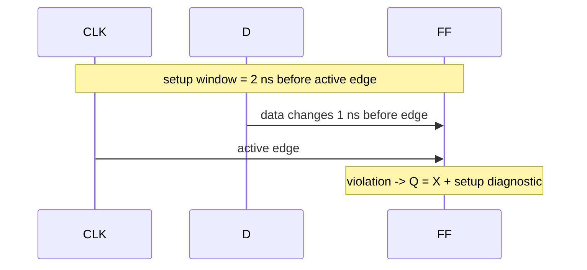
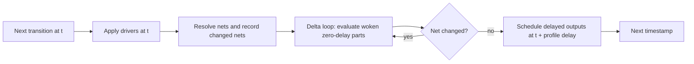

# Physical Timing Mode - Plan

## Goal Capsule

- **Objective:** A student can run a clocked logic design, see gate-delay glitches and near-edge captures, and learn from a diagnostic why a sequential result became X.
- **Means:** A third physical-timing simulation mode with real-time delay profiles, transport-delay events, and sequential timing checks (KTD2).
- **Product authority:** `PRODUCT.md` makes trust in a simulated result the product's first principle, and the owner asked for realistic gate and sequential timing. Surrounding analog and mixed-signal work is not active scope.
- **Execution profile:** One PR; implementation, tests, and the product capability note ship together.
- **Who finishes:** `ce-work` implements and verifies; `lfg` ships the single PR.
- **Stop conditions:** Stop if transport delay cannot preserve existing delta/timed behavior, or if a timing violation cannot be made deterministic; report the blocker rather than weakening the model.
- **Open blockers:** None.
- **Product Contract preservation:** scope unchanged; deferred Outstanding Questions are resolved in place; no R/A/F/AE meaning changed.

---

## Product Contract

### Summary

Add a third physical-timing mode beside delta-cycle and unit-delay timed simulation. Gates and sequential parts carry real-time delays, so unequal paths produce glitches and near-edge captures produce X plus a timing diagnostic. Existing modes and saved projects keep working unchanged.

### Problem Frame

A student building clocked logic needs to know whether a design is reliable, not only whether its steady-state values are correct. Delta-cycle mode treats every gate as instantaneous. Unit-delay timed mode gives every dependency the same abstract tick, so path differences disappear and a data edge close to a clock edge looks safe.

The cost appears when the design leaves the simulator. A circuit that simulates cleanly can fail on hardware because a flip-flop captured data inside its setup window, or because a short pulse existed only long enough to matter. The simulator currently offers no way to see either event, so the student cannot connect the failure to its cause.

### Key Decisions

- **Physical-timing mode with scheduled events.** A third mode runs real-time events and leaves delta-cycle and unit-delay timed mode untouched. Governs R1, R8, R10. (session-settled: user-directed — chosen over quantized ticks and SPICE coupling: full sequential timing without mixed-signal scope.)
- **Real time units.** Delays and constraints use nanoseconds or microseconds. Governs R2, R3, R12. (session-settled: user-directed — chosen over integer ticks: setup/hold values need datasheet-like durations.)
- **Full sequential timing, excluding asynchronous checks.** Clock-to-Q, setup, and hold are modeled; recovery/removal waits for asynchronous controls. Governs R12, R13, R14. (session-settled: user-directed — chosen over combinational-only or gate-plus-wire delay: wanted complete sequential timing, not only glitches.)
- **Per-kind defaults with per-instance overrides.** Each timing-bearing part starts with a useful default and can be tuned independently. Governs R4. (session-settled: user-directed — chosen over per-kind-only, per-instance-only, or fixed built-in values: CPU-scale setup stays fast while one part can match a datasheet.)
- **Transport delay.** Short pulses propagate instead of being filtered. Governs R8, R9. (session-settled: user-directed — chosen over inertial filtering: glitches must remain visible.)
- **Deterministic violation handling.** A setup or hold violation drives X and raises a diagnostic; metastability is not randomized or timed. Governs R13, R15. (session-settled: user-directed — chosen over probabilistic or timed metastability: repeatable, teachable results.)
- **Clock-derived stimulus.** Data edges are produced by gate chains driven from the clock, not by a dedicated timed source. Governs R17. (session-settled: user-directed — chosen over a dedicated timed source or manual toggling: reproducible violations without another primitive.)

### Requirements

**Mode and configuration**

- R1. Physical timing is a third logic simulation mode beside delta-cycle and unit-delay timed.
- R2. Physical timing expresses delays and constraints in real time units, using nanoseconds or microseconds consistently in the UI and waveform.
- R3. The clock exposes period and duty cycle in physical timing, with a per-kind default and a per-instance override.
- R4. Each timing-bearing logic part has a per-kind default timing profile and a per-instance override for its delay and sequential constraints.
- R5. Timing-bearing parts are gates, muxes, decoders, adders, comparators, flip-flops, registers, counters, and shift registers.
- R6. Subcircuits inherit the timing of their flattened contents; no separate subcircuit boundary delay is modeled.
- R7. Nets and wires are ideal; interconnect delay is not modeled.

**Delay semantics**

- R8. An input change produces the corresponding output change after that part's propagation delay; unequal path delays can produce glitches.
- R9. Transport delay is used: a pulse shorter than a part's delay is not filtered out.
- R10. Simultaneous events resolve deterministically, and the simulator caps runaway event loops with an oscillation or event-limit diagnostic.
- R11. The waveform viewer shows physical-timing transitions on a real-time axis and preserves glitch pulses at its available resolution.

**Sequential timing**

- R12. At an active clock edge, a sequential part captures data only when its setup and hold constraints are met.
- R13. A setup or hold violation drives the affected outputs X and raises a diagnostic naming the violated constraint, the component, and the time window.
- R14. Sequential outputs change after the part's clock-to-Q delay.
- R15. A data input that is already X does not raise a timing violation; it propagates X as it does today.
- R16. Changing timing values or switching simulation mode resets simulation state; no mixed-mode state carries over.

**Demonstration and compatibility**

- R17. A D flip-flop can be driven by data derived from the clock through a gate chain, and delaying that chain until the data edge falls inside the setup window produces the X-plus-diagnostic result.
- R18. Existing logic projects open unchanged; physical timing applies the per-kind defaults from R4, and delta-cycle and unit-delay timed results are unchanged.

### Key Flows

- F1. Reproduce a setup violation
  - **Trigger:** A student selects physical timing for a logic project.
  - **Steps:** Place a D flip-flop, configure the clock period, derive D from the clock through a gate chain, and tune the chain delay until the data edge falls inside the setup window. Run the simulation and inspect the X output, diagnostic, and waveform.
  - **Outcome:** The student sees which constraint failed and can adjust the chain to move the edge.
  - **Covers R1, R3, R4, R13, R17.**

- F2. Observe a glitch
  - **Trigger:** Two paths with different delays reconverge at a gate.
  - **Steps:** Set the per-kind defaults or per-instance overrides that create the path difference, run physical timing, and inspect the output in the waveform.
  - **Outcome:** The short pulse appears instead of being reduced to the steady-state value.
  - **Covers R8, R9, R11.**

- F3. Adjust a part's timing
  - **Trigger:** A student selects a timing-bearing part and edits its delay or constraint values.
  - **Steps:** Commit the value, observe the simulation reset, and rerun.
  - **Outcome:** The new timing applies deterministically to the next run.
  - **Covers R4, R16.**

### Acceptance Examples

- AE1. Setup violation
  - **Covers R12, R13, R17.**
  - **Given:** A D flip-flop with a 2 ns setup constraint, and D driven from the clock through a chain adjusted so D changes 1 ns before the active edge.
  - **When:** Physical timing runs past that edge.
  - **Then:** Q and QN are X, and the diagnostic names setup, the flip-flop, and the 2 ns window.



- AE2. Hold violation
  - **Covers R12, R13.**
  - **Given:** A D flip-flop with a 1 ns hold constraint, and D changes 0.5 ns after the active edge.
  - **When:** Physical timing runs past that edge.
  - **Then:** Q and QN are X, and the diagnostic names hold, the flip-flop, and the 1 ns window.

- AE3. Glitch survives
  - **Covers R8, R9, R11.**
  - **Given:** Two paths with different delays reconverge at a gate.
  - **When:** The input changes and the paths disagree for a short interval.
  - **Then:** The output shows a pulse in the waveform rather than only the final value.

- AE4. Clock period and duty
  - **Covers R3.**
  - **Given:** A clock with a 20 ns period and 50% duty.
  - **When:** Physical timing runs for several periods.
  - **Then:** Active edges occur at the expected real-time positions.

- AE5. Unknown data is not a timing violation
  - **Covers R15.**
  - **Given:** D is already X during the setup window.
  - **When:** The active clock edge arrives.
  - **Then:** Q is X, and no setup or hold diagnostic is raised.

- AE6. Existing modes unchanged
  - **Covers R1, R18.**
  - **Given:** A project that runs in delta-cycle or unit-delay timed mode.
  - **When:** The project is opened and run after this work ships.
  - **Then:** Its results match the current behavior.

### Success Criteria

- The setup-violation demo produces Q = X and a setup diagnostic on every run, with identical results across repeated runs.
- A reconvergent circuit shows a glitch in the waveform without inertial filtering.
- A student can configure the clock period and one instance delay from the UI without editing files.
- R18 holds: existing delta-cycle and unit-delay timed tests and saved projects remain green and unchanged.

### Scope Boundaries

**Deferred for later**

- Wire and interconnect delay.
- Memory access time for RAM, ROM, and register files.
- Asynchronous reset/preset pins and their recovery/removal checks; no current sequential part exposes an asynchronous control.
- Inertial pulse filtering.
- Probabilistic or timed metastability.
- A dedicated timed stimulus source; the first version derives data edges from the clock through gates.
- Clock jitter and clock skew.
- Mixed analog/digital timing.

**Outside this product's identity**

- SPICE-level digital gate modeling and full mixed-signal co-simulation.
- PCB or real-part timing extraction.

### Dependencies / Assumptions

- The existing component `params` surface can carry timing values without a document schema migration; existing projects remain readable.
- Default timing values are educational and are not calibrated to a specific logic family.
- Clock polarity is stored by the UI but is not read by the engine today; physical timing uses rising edges and labels the control as not used in physical timing.
- Delta-cycle and unit-delay timed mode remain the compatibility baseline for existing projects and tests.
- Subcircuits are flattened before simulation, so their internal delays aggregate without a separate boundary rule.

### Outstanding Questions

None. The deferred planning questions are resolved in the Planning Contract: timing defaults in KTD3 and U1, Inspector controls in KTD7 and U6, and the event cap and diagnostics in KTD6 and U4.

### Sources / Research

- `PRODUCT.md` establishes trust in a simulated result as the first product principle and names delta-cycle and timed logic simulation as current capabilities.
- `docs/plans/2026-10-04-1543-feat-circuitgate-logic-v1-plan.md` records KTD4: zero-delay delta-cycle settling plus a uniform unit-delay timed mode.
- `frontend/src/lib/engine/evaluate.ts` shows the current settle loop and the integer-tick timed queue.
- `frontend/src/lib/engine/primitives/flipflops.ts` confirms that current flip-flops expose no asynchronous reset or preset input.
- `frontend/src/lib/sim/recorder.ts` and `frontend/src/lib/components/waveform/lane.ts` show that waveform history and axis mapping are tick-based.
- `frontend/src/lib/sim/diagnostics.ts` and `frontend/src/lib/components/sim/Diagnostics.svelte` provide the existing diagnostics surface.
- `frontend/src/lib/engine/__tests__/evaluate.test.ts` and `frontend/src/lib/sim/__tests__/protocol.test.ts` pin the current unit-delay behavior.

---

## Planning Contract

### Key Technical Decisions

- KTD1. **Integer-picosecond time base.** Simulated time is an integer number of picoseconds in physical mode. Component params store nanoseconds, clock duty stores percent, and conversion rounds `ns * 1000` to the nearest ps; zero stays zero and a positive sub-ps value becomes 1 ps. `tick` stays an integer on the wire and in the recorder, meaning ticks in existing modes and picoseconds in physical mode. Governs R2, R11, R14. The recorder, lane geometry, and protocol already require non-negative integers, so float time would reopen all three contracts and make ordering nondeterministic.

- KTD2. **Value-at-production physical events.** Physical mode schedules `(timePs, sequence, component, pin, value)` transitions, applies due transitions, resolves drivers, runs a bounded same-time delta subloop for zero-delay and unprofiled parts, and schedules delayed outputs. A separate physical queue keyed by time and sequence preserves distinct transitions; the timed queue keeps its current `(tick, index)` behavior. `ComponentKind` and its object identity stay unchanged. Governs R1, R7, R8, R9, R10. The timed path recomputes outputs at delivery, so it cannot carry a pulse through a delayed part; value-at-production is what makes transport delay and reconvergent glitches real.

- KTD3. **Timing profiles resolved at compile.** `frontend/src/lib/engine/timing.ts` owns per-kind defaults, param keys, validation, and field lists; conversion helpers live in `frontend/src/lib/engine/time.ts`. `compileWithResolver` receives an optional timing resolver and stores the resolved profile on each compiled component. Defaults never enter `FAMILIES.defaults` or placement params; absent params resolve to the default, and explicit overrides persist. Governs R2, R3, R4, R5, R18. Keeping timing out of the primitive factories leaves every value behavior unchanged and stops new documents from freezing today's defaults.

- KTD4. **Sequential checks use last-transition evidence.** The scheduler records the last time each net's resolved value changed. Setup uses `[edge - setup, edge]`; hold uses `[edge, edge + hold]`; both ends are inclusive, and same-time transitions apply before the check. Every non-clock input of a clocked part is checked; a violation drives every output and the internal state X. X or Z data produces X without a timing diagnostic. The first active edge establishes the clock state and is exempt from timing diagnostics; checks begin with the next active edge, so the clock's initial low propagation cannot create a power-up violation. A capture commits at `edge + max(hold, clockToQ)` after the hold window closes. A DFF, JK/SR flip-flop, or register recovers on the next compliant edge that samples a known value; a counter stays X until a defined load or reset, and a shift register stays X until enough known serial inputs shift the X bits out or a reset/load applies. `srLatch` remains asynchronous with a delay only. Governs R12, R13, R14, R15. A hold violation is not knowable at the edge, and emitting Q first would create a second glitch; withholding the commit keeps the result deterministic.

- KTD5. **Physical clock phase and period validation.** The clock starts low at t=0. Duty is the high percentage; the first rising edge is at `(1 - duty/100) * period`, the falling edge at `period`, and the pattern repeats. Clocked parts use rising edges; the existing polarity control is labeled as not used in physical timing. Period must be positive and duty strictly between 0 and 100. When a clock net directly drives a clocked part, the period must exceed that part's `max(hold, clockToQ) + setup`; a compile-time check rejects a shorter period with a timing error, and the store surfaces the same rule. Governs R3, R17. The convention makes the first active edge capturable and gives the demo a repeatable position; falling-edge parts do not exist in the current primitive set, and overlapping captures are rejected rather than resolved by queue order.

- KTD6. **Step, Run, and event-to-frame contract.** One Step processes all events at the next scheduled timestamp. A Run turn processes at most 100,000 events across timestamps on a yielding macrotask, re-checks `isRunning` between timestamps, and stops on Pause. Each timestamp emits one values frame containing every net transition, without coalescing distinct transitions. A single timestamp that would exceed 100,000 events is not applied; the run pauses with `event-limit`, an event-limit diagnostic, and requires Reset. Run also pauses on the first new timing diagnostic id, at the violating timestamp, so the X remains visible. Governs R1, R10, R11, R16. The existing flush keeps only the last change per net, which would erase the glitch; one timestamp per frame preserves every transition, and the macrotask yield keeps Pause reachable.

- KTD7. **Timing UI and diagnostics.** Controls adds physical mode, a formatted time readout, and a pause reason. The waveform draws a real-time axis and a minimum one-pixel marker for a pulse narrower than a pixel. The Inspector exposes a labeled "Physical timing (applies in physical mode)" fieldset with effective defaults, an explicit default-versus-override state, unit-aware inputs, reset-to-default, and an inactive state when the session is not in physical mode. Diagnostics add `timing` and `event-limit` kinds. A timing diagnostic uses a stable `timing:<constraint>:<componentId>` id, `time` as the active edge, and `window` as the absolute inclusive interval; a recurrence refreshes time and window, a compliant edge clears that component's timing diagnostic, and reset, mode change, and worker respawn clear all. An event-limit diagnostic uses `kind: 'event-limit'` and id `event-limit`, with no component or window. Governs R11, R13, R16, R18. A timing value that cannot be seen, located, or cleared is worse than no control; the fieldset and diagnostics share the same profile metadata.

### High-Level Technical Design

Physical mode is a separate path inside the simulator. `settle`, `runTimed`, `stepTimed`, and the existing timed queue keep their current behavior; physical events carry values and timestamps so transport delay survives.



A clocked part samples at the edge, waits for the hold window to close, and only then exposes the captured value or X:

```mermaid
flowchart TB
  A[Clock edge at t] --> B[Apply same-time data transitions]
  B --> C[Check setup window]
  C -->|setup violation| X[State and all outputs X]
  C --> D[Schedule hold check at t + hold]
  D --> E{Hold violation?}
  E -->|yes| X
  E -->|no| Q[Commit captured value]
  X --> R[Commit at t + max(hold, clockToQ)]
  Q --> R
```

### Assumptions

- The existing `tick` field remains the integer time coordinate; physical mode reinterprets it as picoseconds. No protocol version bump is needed because the mode and fields are additive.
- Mode selection is session-local; reopening a project returns to delta-cycle, as it does today.
- Per-instance overrides are per document component; components inside a subcircuit definition are shared by every instance under the existing flattening behavior.
- Memory access time, switch latency, and probe/LED/display latency are zero; unprofiled kinds run in the same-time delta subloop.
- Diagnostics for components inside a subcircuit include the flattened path in the message; focusing a component inside a subcircuit is best-effort.
- Waveform retention stays at the existing 4096 changes per net; a long physical run may truncate the visible window. Horizontal zoom is deferred.
- The event limit pauses the advance and requires Reset before Run or Step resumes; it does not mark nets X.
- Timing defaults are educational values, not calibrated to a specific logic family.
- The first active edge after power-up establishes the clock state and is exempt from setup/hold diagnostics; the next active edge starts timing checks.

### Implementation Constraints

- Keep `ComponentKind`, `CompiledComponent.kind`, and primitive `evaluate` semantics unchanged; do not clone or wrap kind objects, because switch toggling compares kind identity.
- Keep `settle`, `runTimed`, `stepTimed`, and `EventQueue` behavior unchanged; add the physical path alongside them.
- Protocol changes are additive: `SimulationMode` gains `physical`, `SimulationStatus` gains `event-limit`, diagnostics gain `timing` and `event-limit`, and `StatusEvent` gains an optional pause reason. Do not bump `PROTOCOL_VERSION`; add any new command type to `COMMAND_TYPES` or the worker drops it.
- Physical Run must yield on a macrotask between bounded bursts so worker messages can reach `handle`; do not use a continuous microtask chain.
- An event-limit stop pauses the run and requires Reset before Run or Step resumes.
- No document schema change: timing lives in `components[].params`; do not materialize timing defaults at placement and do not add a project-level timing section.
- Cross-field clock validation belongs in the compile/physical seam, with the same rule surfaced by the store when a clock directly drives a clocked part.
- Use the existing `resolveDrivers`, `DiagnosticsStore`, `parseSI`/`formatSI`, `ManualScheduler`, and `FakeWorker` seams; do not add a dependency.
- Physical commits report changed net indexes; do not scan every net on every timestamp.
- The work ships as one PR.

### Alternative Approaches Considered

- **Reuse the timed tick scheduler with quantized delays.** Rejected: the timed path recomputes outputs at delivery, so it cannot carry a pulse through a delayed part; sub-tick setup and hold would collapse to the tick grid.
- **Add `evaluatePhysical` to each primitive kind.** Rejected: it duplicates the value semantics of every sequential primitive and makes divergence from delta/timed behavior likely. Engine-side profiles keep one `evaluate` implementation per kind.
- **Use floating-point seconds internally.** Rejected: the recorder, lane geometry, and protocol already require non-negative integers; floats add ordering and equality failures for no user-visible gain.
- **Materialize timing defaults when a component is placed.** Rejected: new documents would freeze today's defaults while old documents resolve them at compile time, and reset-to-default would have no clean meaning.

### System-Wide Impact

- Engine: new time utilities, timing registry, physical scheduler, and sequential checks; existing delta/timed paths untouched.
- Simulation boundary: additive mode and status values, per-timestamp values frames, timing diagnostics, and event-limit handling across the host and worker protocol.
- Editor: timing fieldset in the Inspector, store validation and reset-to-default, and a clock note for the inert polarity control.
- Visualization: real-time waveform labels, sub-pixel pulse markers, and formatted time readout in the simulation controls.
- Persistence: timing overrides remain in existing component params; no backend, schema, or import/export change.
- Compatibility and performance: existing modes and fixtures stay green; event rate is bounded by the event cap, changed-net commits, and the worker boundary.

### Risks & Dependencies

| Risk | Mitigation |
|---|---|
| Transport events multiply on bus-width parts and combinational loops. | Keep the same-time delta subloop separate from delayed events, cap each timestamp at 100,000 events, and add a `RUN_PERF_SMOKE` physical scheduler test with a generous ceiling. |
| A worker Run loop can starve Pause if it yields on microtasks. | Process a bounded burst on a macrotask, re-check `isRunning` between timestamps, and add a Run-to-Pause worker-backed test. |
| A clock period shorter than the sequential commit latency lets captures overlap edges. | Compile-time and store validation require period > `max(hold, clockToQ) + setup` for directly clocked parts. |
| Hold-aware commit delays Q by up to the hold window. | State the rule in KTD4, cover it in AE2, and test both `hold < clockToQ` and `hold > clockToQ` cases. |
| Clock polarity is an existing control that does nothing in physical mode. | Keep rising-edge clocking, label the control as not used in physical timing, and test the note in the Inspector. |
| Subcircuit timing overrides are shared by every instance, and flattened diagnostic ids may not be selectable. | State the sharing in Assumptions, include the flattened path in diagnostics, and treat focus as best-effort. |
| Waveform retention and pixel resolution can hide narrow pulses. | Use 1 ps resolution, add a minimum one-pixel marker for sub-pixel segments, and state that horizontal zoom is deferred. |
| Repeated violations can flood the diagnostics panel or leave a stale window. | Keep one entry per constraint and component, refresh its time/window on recurrence, clear it on a compliant edge, and clear all on reset, mode change, and respawn. |
| A Run burst can flood the main thread with values frames. | Bound each burst by the 100,000-event cap, yield between bursts, and keep the existing recorder retention. |
| Mode selection is lost on reload. | Keep it session-local, matching today, and state the behavior in Assumptions. |
| Timing defaults or param names could leak into saved documents. | Resolve defaults at compile time, store only explicit overrides, and test a no-timing-param document round trip. |
| Existing timed and delta behavior is easy to regress while adding a scheduler. | Keep the existing methods untouched, run the existing unit/protocol/e2e suites, and use the pre-change fixtures as the compatibility gate. |
| Memory, probes, and other unprofiled parts could be mistaken for timed parts. | Treat them as zero-delay delta parts and name that in Assumptions and tests. |

### Documentation Plan

- Update the logic capability line in `PRODUCT.md` to name physical timing and note that defaults are educational.
- Add code comments where the picosecond quantum, clock phase, and hold-aware commit rule are not self-evident.
- No user manual or migration guide is required; timing params are additive and defaults are resolved at compile time.

---

## Implementation Units

All units ship in one PR. Unit order is dependency order.

### U1. Timing profile registry and time utilities

- **Goal:** Establish one source of truth for timing fields, per-kind defaults, parameter keys, validation, and nanosecond-to-picosecond conversion.
- **Requirements:** R2, R3, R4, R5, R18.
- **Dependencies:** None.
- **Files:**
  - `frontend/src/lib/engine/time.ts` (new)
  - `frontend/src/lib/engine/timing.ts` (new)
  - `frontend/src/lib/engine/__tests__/timing.test.ts` (new)
  - `frontend/src/lib/engine/__tests__/parameterized.test.ts` (guard only)
- **Approach:**
  - `time.ts` owns `PS_PER_NS`, `nsToPs`, `psToNs`, and `formatTimePs`; conversion rounds to the nearest picosecond, leaves zero at zero, and lifts a positive sub-picosecond value to 1 ps.
  - `timing.ts` owns `TimingProfile`, `TimingField`, `TIMING_PARAM_KEYS`, `timingFieldsForKind`, `timingForComponent`, and `validateTimingParam`.
  - Defaults: gates and buffers 2 ns; muxes, decoders, and seven-segment decoder 3 ns; half adder 3 ns; full adder 4 ns; ripple adder and comparator 6 ns; clock-to-Q 4 ns, setup 2 ns, hold 1 ns for DFF/JK/SR/register/counter/shift; SR latch delay 2 ns; clock 20 ns period and 50% duty; switch, probe, LED, display, RAM, ROM, and register file 0 ns.
  - Params store nanoseconds for time and percent for duty. Invalid values throw `CompileError` with a stable timing code. Timing defaults never enter `FAMILIES.defaults`.
- **Patterns to follow:** `frontend/src/lib/engine/kinds.ts` parameter parsing, `frontend/src/lib/engine/primitives/pins.ts` validators, and `frontend/src/lib/engine/analog/si.ts` unit formatting.
- **Test scenarios:**
  - Defaults resolve for every timing-bearing kind and for the clock.
  - An absent param returns the kind default; an explicit override wins.
  - 0.5 ns converts to 500 ps; 0.0001 ns lifts to 1 ps; 0 ns stays 0.
  - Negative, NaN, non-numeric, zero-period, and 0/100 duty values throw a timing `CompileError`.
  - `defaultParamsForKind` remains unchanged for every parameterized family.
  - Memory, sinks, switches, and unknown kinds resolve to a zero-delay profile.
- **Verification:** The timing test file passes and the existing parameterized defaults test is unchanged.

### U2. Physical event scheduler and transport delay

- **Goal:** Run a real-time event loop that carries output values to a future timestamp, resolves nets deterministically, and keeps zero-delay parts in a same-time delta subloop.
- **Requirements:** R1, R6, R7, R8, R9, R10.
- **Dependencies:** U1.
- **Files:**
  - `frontend/src/lib/engine/physical.ts` (new)
  - `frontend/src/lib/engine/eventQueue.ts` (add a physical queue; keep the timed queue)
  - `frontend/src/lib/engine/compile.ts` (optional timing field and timing resolver)
  - `frontend/src/lib/engine/evaluate.ts` (physical methods and options)
  - `frontend/src/lib/engine/__tests__/physical.test.ts` (new)
- **Approach:**
  - Add an optional `TimingProfile` to a compiled component; `compileWithResolver` accepts an optional timing resolver and resolves each profile once.
  - Add a physical queue keyed by `(timePs, sequence)` with payload `(component, pin, value)`; distinct transitions and glitches must not be deduplicated.
  - At each timestamp, apply due transitions, resolve drivers, record changed nets, and run a bounded same-time delta loop for zero-delay and unprofiled parts. Schedule timing-bearing outputs at `time + delay`.
  - Seed clock transitions from the resolved clock profile; a switch toggle schedules a source transition at the current time.
  - Expose `maxPhysicalEvents` as an optional engine/host option with a 100,000 default so tests can exercise the cap with a small value.
  - Keep the existing `settle` and timed methods untouched. Return changed net indexes and status per timestamp, not a full-net scan.
- **Patterns to follow:** `frontend/src/lib/engine/evaluate.ts` current timed loop, `frontend/src/lib/engine/eventQueue.ts` heap mechanics, `frontend/src/lib/engine/values.ts` driver resolution, and `frontend/src/lib/engine/hierarchy.ts` flattened component ids.
- **Test scenarios:**
  - A buffer with a 2 ns delay changes its output at 2 ns, not at 0.
  - A reconvergent 2 ns/5 ns path produces a pulse between 2 ns and 5 ns (Covers AE3).
  - Two distinct transitions at the same timestamp both survive the queue.
  - Simultaneous events resolve in deterministic time/sequence order across repeated runs.
  - A zero-delay combinational chain settles at one timestamp; a feedback loop hits the delta cap and reports oscillation.
  - A 20 ns, 50% clock produces rising edges at 10 ns and falling edges at 20 ns (Covers AE4).
  - A timestamp that would exceed 100,000 events is not applied; the run stops with `event-limit` status and an event-limit diagnostic.
  - A subcircuit containing a gate with an overridden delay shows exactly that delay at the flattened path and adds no boundary delay (Covers R6).
  - Tri-state and Z driver resolution remains the existing `resolveDrivers` behavior.
  - A RAM or ROM read with no timing profile stays zero-delay.
  - A `RUN_PERF_SMOKE=1` physical scheduler smoke runs a 20 ns clock through a short inverter chain for several periods and completes under a generous 2 s ceiling.
- **Verification:** Physical scheduler tests pass; the `RUN_PERF_SMOKE=1` physical smoke meets its ceiling; the existing evaluate and timed protocol tests remain green.

### U3. Sequential timing checks

- **Goal:** Detect setup and hold violations from real transition times, apply clock-to-Q, drive X, and recover on a later compliant edge.
- **Requirements:** R12, R13, R14, R15.
- **Dependencies:** U1, U2.
- **Files:**
  - `frontend/src/lib/engine/physical.ts` (scheduler and sequential checks)
  - `frontend/src/lib/engine/__tests__/physicalSequential.test.ts` (new)
- **Approach:**
  - Track the last resolved transition time for each net and compare it with the active edge.
  - Check every non-clock input of a clocked part: D, J/K, S/R, register data bits, counter reset/enable/load and data bits, and shift reset/load/serials/data bits.
  - Setup window is `[edge - setup, edge]`; hold window is `[edge, edge + hold]`; both ends inclusive. Same-time transitions apply before the check. The first active edge establishes the clock state and is exempt from timing checks; checks begin with the next active edge, so the clock's initial low propagation cannot create a power-up violation.
  - A violation drives every output and the internal state X. X or Z data produces X without a timing diagnostic. A capture commits at `edge + max(hold, clockToQ)`.
  - A DFF, JK/SR flip-flop, or register recovers on the next compliant edge that samples a known value. A counter stays X until a defined load or reset; a shift register stays X until enough known serial inputs shift the X bits out, or a reset/load applies.
  - When a clock net directly drives a clocked part, reject a period not greater than that part's `max(hold, clockToQ) + setup` with a clock-period CompileError.
  - `srLatch` is asynchronous and gets a propagation delay only, with no setup/hold check.
- **Patterns to follow:** `frontend/src/lib/engine/primitives/state.ts` edge detection and `frontend/src/lib/engine/primitives/flipflops.ts`/`sequential.ts` input pin layouts.
- **Test scenarios:**
  - A DFF with 2 ns setup and data changing 1 ns before the edge yields Q/QN X and a setup diagnostic (Covers AE1).
  - A DFF with 1 ns hold and data changing 0.5 ns after the edge yields Q/QN X and a hold diagnostic (Covers AE2).
  - Data changes exactly at a window boundary violate the constraint; data outside the window does not.
  - X or Z data yields X with no timing diagnostic (Covers AE5).
  - A synchronous reset/load violation drives all outputs X.
  - Q appears at `edge + clockToQ` when hold is shorter, and at `edge + hold` when hold is longer.
  - A DFF/register recovers on the next compliant edge; a counter remains X until load/reset; a shift register clears X only after enough known serial inputs or a reset/load.
  - A clock period not greater than `max(hold, clockToQ) + setup` is rejected at compile time.
  - Initial clock settling does not raise a setup/hold diagnostic at the first active edge; the second active edge is checked.
  - Repeated runs with the same document and timing values are identical.
  - The SR latch applies its delay and never raises a setup/hold diagnostic.
- **Verification:** Sequential timing tests pass and the existing sequential primitive tests remain green.

### U4. Simulation protocol and host integration

- **Goal:** Make physical mode work end to end through the worker, with per-timestamp values, timing diagnostics, reset/mode transitions, and event-limit handling.
- **Requirements:** R1, R10, R11, R13, R16.
- **Dependencies:** U1, U2, U3.
- **Files:**
  - `frontend/src/lib/sim/protocol.ts`
  - `frontend/src/lib/sim/session.ts`
  - `frontend/src/lib/sim/diagnostics.ts`
  - `frontend/src/workers/engine.worker.ts`
  - `frontend/src/lib/sim/__tests__/protocol.test.ts`
- **Approach:**
  - Add `physical` to `SimulationMode`, `event-limit` to `SimulationStatus`, and an optional pause reason to `StatusEvent`; keep `PROTOCOL_VERSION` at 1 and do not add a new command type.
  - `SimulationHost.initialize` builds the timing resolver, initializes physical time at 0, and commits the initial slot. `advance` processes one timestamp. A switch schedules a source transition at the current time.
  - Emit one values frame per timestamp with every transition; do not coalesce distinct changes. Commit only changed net indexes.
  - A Run turn processes a bounded burst of timestamps on a macrotask and re-checks `isRunning` between timestamps; do not use a continuous microtask chain. Pause on the first new timing diagnostic id.
  - Add `timing` and `event-limit` to `DiagnosticKind`; add `time` and `window` fields to timing diagnostics, with `time` as the active edge and `window` as the absolute inclusive interval. Use the stable timing id, refresh time/window on recurrence, and emit an additive `cleared` diagnostic event for that id when a compliant edge arrives.
  - Add an upsert to `DiagnosticsStore` for timing recurrences, and clear diagnostics on reset, mode change, and worker respawn. A timestamp that would exceed 100,000 events is not applied; emit `event-limit` status and diagnostic, pause, and require Reset.
- **Patterns to follow:** `frontend/src/lib/sim/session.ts` current mode branches, `frontend/src/lib/sim/__tests__/protocol.test.ts` `ManualScheduler`/`FakeWorker`, and the oscillation diagnostic path.
- **Test scenarios:**
  - Init in physical mode reports the mode and time 0.
  - One Step reaches the next timestamp; a second Step reaches the following one.
  - Two transitions at different timestamps produce two values frames; the first pulse is not overwritten.
  - Run and Pause stop and resume without resetting time; Pause is reachable during a clock-driven run, and a Run turn yields after at most 100,000 events.
  - Reset returns to time 0, clears pending events and sequential state, and clears timing diagnostics.
  - Switching modes resets time and clears diagnostics.
  - A setup violation emits a `timing` diagnostic with the component, constraint, edge time, and absolute window.
  - A recurrence refreshes the same timing diagnostic; a compliant edge clears it.
  - The event cap emits an `event-limit` diagnostic, pauses the run, and requires Reset.
  - Worker respawn emits `restarted` and resets time to 0.
  - Existing delta and timed protocol tests remain unchanged.
- **Verification:** Protocol/host tests pass and the existing timed-mode behavior is unchanged.

### U5. Simulation UI and waveform

- **Goal:** Expose physical mode and simulated time, label timing diagnostics, and make glitches legible on a real-time axis.
- **Requirements:** R11, R13, R18.
- **Dependencies:** U4.
- **Files:**
  - `frontend/src/lib/components/sim/Controls.svelte`
  - `frontend/src/lib/components/sim/SimulationPanel.svelte`
  - `frontend/src/lib/components/sim/Diagnostics.svelte`
  - `frontend/src/lib/components/waveform/WaveformViewer.svelte`
  - `frontend/src/lib/components/waveform/lane.ts`
  - `frontend/src/lib/components/waveform/__tests__/lane.test.ts`
  - `frontend/src/routes/(app)/projects/[id]/+page.svelte`
- **Approach:**
  - Add a `physical` option to the mode select and parse all three modes explicitly; add a `simulation-mode` test id and a `sim-time` readout. Show the pause reason when a timing diagnostic or event limit pauses the run.
  - Lift the simulation mode from `SimulationPanel` to the editor page and pass it to both the panel and the Inspector, so the Inspector can disable timing fields outside physical mode.
  - Format time with `formatTimePs` in physical mode; leave the tick label in delta/timed.
  - Pass mode to the waveform viewer; draw a real-time axis with labeled divisions and a minimum one-pixel marker for a sub-pixel pulse.
  - Label `timing` and `event-limit` diagnostics; render the formatted time/window for timing; clear diagnostics on reset, mode change, and the `restarted` event.
- **Patterns to follow:** `frontend/src/lib/components/sim/SimulationPanel.svelte` event handling, `frontend/src/lib/components/waveform/WaveformViewer.svelte` canvas drawing, and `frontend/src/lib/engine/analog/si.ts` formatting.
- **Test scenarios:**
  - The mode select offers physical and the time readout formats ps as ns/µs.
  - Axis labels divide the visible window into readable real-time positions.
  - A sub-pixel pulse produces the minimum-width marker.
  - A timing diagnostic shows the timing label and formatted absolute window.
  - An event-limit diagnostic shows its own label and pause reason.
  - Reset, mode change, and worker respawn clear timing diagnostics.
  - Existing tick-based waveform tests remain green.
- **Verification:** Waveform unit tests pass and the simulation panel renders all three modes.

### U6. Inspector timing controls and store validation

- **Goal:** Let a student inspect and override timing per component without leaking defaults into documents or letting invalid values through.
- **Requirements:** R3, R4, R16, R18.
- **Dependencies:** U1, U4.
- **Files:**
  - `frontend/src/lib/components/editor/Inspector.svelte`
  - `frontend/src/lib/state/circuitStore.ts`
  - `frontend/src/lib/state/__tests__/editor.test.ts`
  - `frontend/src/lib/state/__tests__/document-preservation.test.ts`
- **Approach:**
  - Add a labeled "Physical timing (applies in physical mode)" fieldset driven by `timingFieldsForKind`: delay for combinational parts, clock-to-Q/setup/hold for sequential parts, period/duty for the clock.
  - Disable the fieldset with an inline "Timing values apply only in physical timing" note when the current simulation mode is delta or timed; keep the stored values intact.
  - Show the effective default as a muted value with a "Default" hint and a disabled reset control while no override exists; after an override, show the explicit value with an enabled reset-to-default action.
  - Parse unit-aware ns input and duty percent; hide timing keys from the generic parameter list. Add store validation for finite, non-negative time values, positive period, and duty strictly between 0 and 100.
  - When a clock net directly drives a clocked part, reject a period not greater than that part's `max(hold, clockToQ) + setup` and surface the same message the compile check uses.
  - Do not materialize defaults at placement. Note that the existing clock polarity control is not used in physical timing. Timing edits restart the session through the existing document-identity path.
- **Patterns to follow:** `frontend/src/lib/components/editor/Inspector.svelte` numeric field/error pattern, `frontend/src/lib/state/circuitStore.ts` `setBusWidth`/`setParam`, and `frontend/src/lib/state/__tests__/editor.test.ts` parameter tests.
- **Test scenarios:**
  - Valid delay, clock-to-Q, setup, hold, period, and duty values persist as explicit params.
  - Invalid negative, NaN, zero-period, and 0/100 duty values are rejected without mutating the document.
  - A clock period not greater than a directly connected part's `max(hold, clockToQ) + setup` is rejected.
  - Reset-to-default removes the override and the Inspector shows the kind default.
  - The fieldset is disabled with the mode note in delta and timed modes, and editing re-enables in physical mode.
  - The default and override states render differently, with reset disabled for a default.
  - Timing keys do not appear in the generic parameter list.
  - A document with no timing params saves and reloads unchanged.
  - A timing edit restarts the simulation and clears the waveform/diagnostics.
  - The clock fieldset shows period/duty and the polarity note.
- **Verification:** Store tests pass and the Inspector typecheck is clean.

### U7. End-to-end timing demos and documentation

- **Goal:** Prove the setup violation and glitch are user-visible, and keep the existing modes demonstrably unchanged.
- **Requirements:** R13, R17, R18; AE1, AE3, AE4, AE6.
- **Dependencies:** U4, U5, U6.
- **Files:**
  - `frontend/tests/fixtures/physical-timing-setup.json` (new)
  - `frontend/tests/fixtures/physical-timing-glitch.json` (new)
  - `frontend/tests/e2e/physical-timing.spec.ts` (new)
  - `PRODUCT.md`
- **Approach:**
  - The setup fixture is a clock, a D flip-flop, and a clock-driven inverter chain tuned so D changes 1 ns before the second rising edge; probes expose CLK, D, Q, and QN.
  - The glitch fixture is a switch driving a 2 ns path and a delayed inverted path into an AND gate; a probe exposes the pulse.
  - The e2e selects physical mode, steps/runs to the relevant time, asserts the time readout, the diagnostic, and the probe values; it also switches back to delta/timed for the compatibility check.
  - Update the logic capability line in `PRODUCT.md` and leave the rest of the product contract unchanged.
- **Patterns to follow:** `frontend/tests/e2e/logic.ts` fixture loading, `frontend/tests/e2e/parameterized-nodes.spec.ts` Inspector interactions, and `frontend/tests/fixtures/oscillator-project.json` document shape.
- **Test scenarios:**
  - The setup fixture shows Q/QN X and a setup diagnostic after the violating edge (Covers AE1).
  - Run pauses on the first new timing diagnostic at the violating timestamp, leaving Q/QN X visible; the pause reason is shown.
  - A Run-to-Pause sequence on a clock-driven circuit completes without starving the worker.
  - The glitch fixture shows a high pulse followed by low on the probe (Covers AE3).
  - The clock readout shows a 20 ns period with a 10 ns first rising edge (Covers AE4).
  - The existing oscillator and parameterized specs remain unchanged (Covers AE6).
  - A project with no timing params, after switching to physical mode, uses defaults and saves without timing keys (Covers R18).
- **Verification:** The new e2e spec passes alongside the existing logic specs.

---

## Verification Contract

| Gate | Command | Applies to | Pass signal |
|---|---|---|---|
| Unit and integration | `cd frontend && bun run test` | U1-U7 | All Vitest files pass. |
| Types and Svelte | `cd frontend && bun run check` | U1-U7 | 0 errors and 0 warnings. |
| Browser | `cd frontend && bunx playwright test tests/e2e/physical-timing.spec.ts tests/e2e/parameterized-nodes.spec.ts tests/e2e/assist-stepping.spec.ts tests/e2e/oscillator.spec.ts` | U5-U7 | All listed specs pass. |
| Performance smoke | `cd frontend && bun run test:perf` | U2 | The physical scheduler smoke runs and completes under its 2 s ceiling; the existing delta p95 gate is unchanged. |
| Diff hygiene | `git diff --check` | All units | No whitespace errors. |

Run the frontend commands from `frontend/` in the project frontend container.

## Definition of Done

- R1-R18 and AE1-AE6 are satisfied by the implementation and tests.
- Unit, typecheck, browser, and diff-hygiene gates pass.
- Existing delta and unit-delay timed behavior, tests, and saved fixtures remain unchanged.
- Timing overrides round-trip through save/export; documents with no timing params remain unchanged and use defaults at compile time.
- Timing diagnostics are labeled, time-stamped, refreshed on recurrence, and cleared on recovery, reset, mode change, and worker respawn.
- A new timing diagnostic pauses the run with a visible reason; the run loop does not starve Pause.
- The event limit pauses the advance, emits its own diagnostic, and requires Reset instead of hanging the worker.
- The setup demo produces X plus a diagnostic, and the glitch demo shows a pulse on the real-time waveform.
- A directly clocked part rejects a period that does not exceed `max(hold, clockToQ) + setup` at compile time and in the store.
- The timing fieldset is disabled with a mode note outside physical mode, and default versus override states are visible.
- `PRODUCT.md` names physical timing, and the timing/quantum/hold-commit comments explain the non-obvious rules.
- No abandoned experimental code or dead timing path remains in the diff.

---

## Deferred / Open Questions

These are review items left for the author; they do not block implementation.

### From 2026-11-19 review

- **R5 omits the SR latch** — Requirements (P3, coherence, confidence 75)

  R5 reads as the exhaustive list of timing-bearing parts, but the plan gives the asynchronous SR latch a 2 ns propagation delay, so the delay has no requirement behind it. Change: add "SR latches" to R5's list.

- **Per-instance timing inside reusable subcircuits** — Assumptions (P2, scope-guardian, confidence 75)

  A timing edit inside a reusable subcircuit definition changes every instance, so R4's per-instance override holds only for components in the current document. The plan states the sharing as an assumption; choose whether to add instance-scoped overrides or record the shared-definition limitation as a scope boundary.
